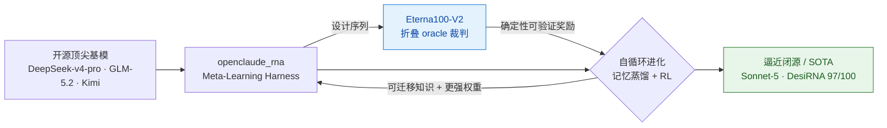
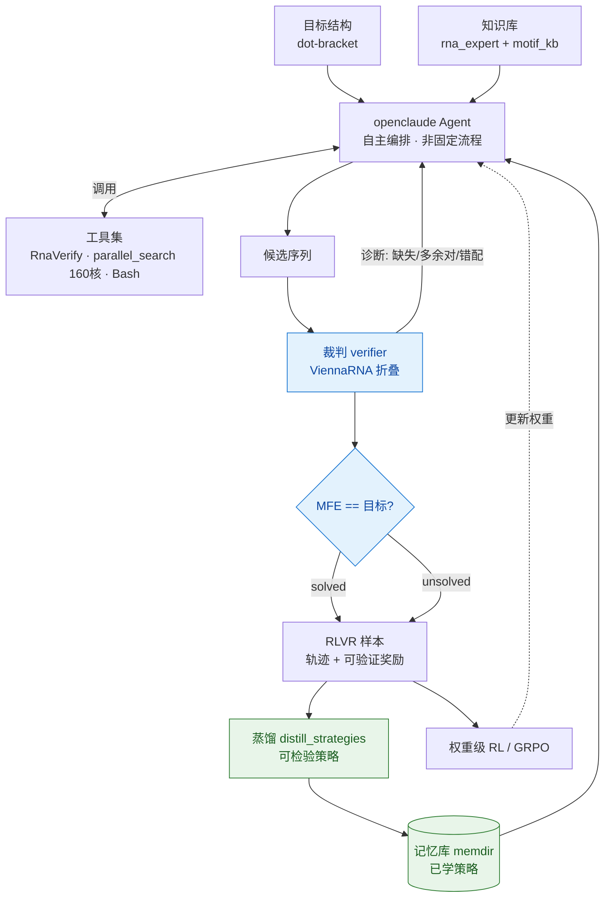
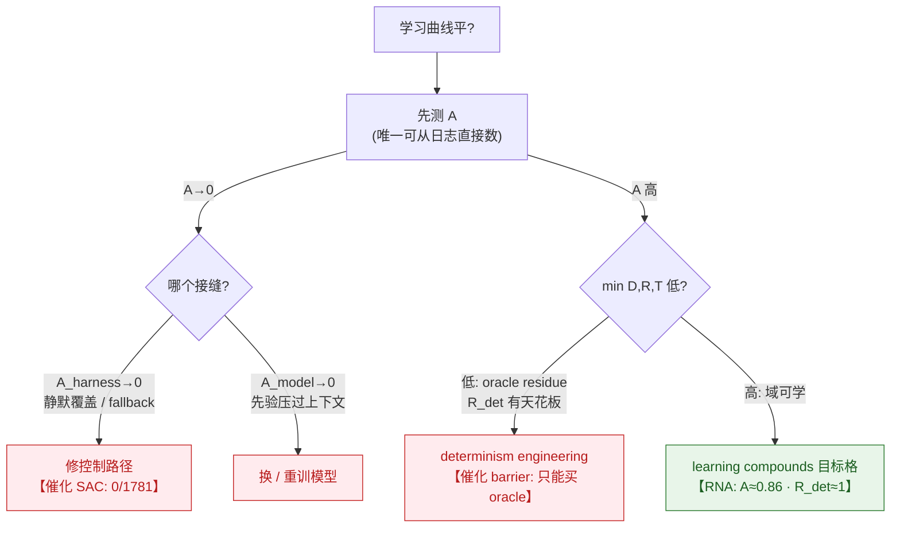

# openclaude_rna:RNA 逆设计 Meta-Learning Harness — 技术框架与技术报告

**版本** 2026-07-03 · **作者** InceptLabs · **裁判环境** ViennaRNA 2.7.2 (Turner2004, T=37°C, dangles=2)

> **红线(全文适用):** 本文所有「成功 / 解出」仅指 **在折叠算法裁判(computational folding oracle)下设计正确**,即设计序列的 MFE 结构字符串等于目标点括号结构。**不代表任何体内(in-vivo)、表达或生物功能上的正确性。**

---

## 摘要

我们构建了一个把通用编码智能体(openclaude,Claude Code 的开源复现)**专化为 RNA 逆设计求解器**的框架,并在其上叠加一个**跨题自改进的元学习层**。框架的目标不是"挑一个最强的静态模型",而是**驱动开源顶尖模型(DeepSeek-v4-pro / GLM-5.2 等)通过自循环进化(记忆蒸馏 + RL),逼近闭源 / SOTA 水平**。

本报告给出**三份纯净基模(无记忆)在 Eterna100-V2 上的横向对照**:GLM-5.2 56/100、Sonnet-5 51/100、DeepSeek-v4-pro 47/100。核心发现:**约 90–98% 的失败是 1500 秒墙超时,而非模型答错**;进一步定位,超时的根因是**经典搜索求解器在难长结构上不收敛**(而非模型推理能力或工具选择)。这既指明了提升路径,也暴露了一个必须警惕的**归因陷阱**。

理论上,本框架直接吸收 InceptLabs 两篇论文——*Actuation Fidelity*(自改进的"环闭没闭")与 *Oracle Residue Thesis*(物理 oracle 的"算力买不回的残差")——并论证 **RNA-under-ViennaRNA 是同时避开这两道坎的 positive control**(详见第三部分):它的奖励确定性 R_det≈1(无 oracle 残差),actuation fidelity 实测 A≈0.86(环已闭),残余瓶颈(搜索)又恰是**可 amortize**的那一类。这正是把"开源模型自进化到 SOTA"先在 RNA 上跑通的理由。

---

## 0. 全景流程

### 0.1 极宏观:自进化闭环(项目使命)

> 开源基模 →(本框架)→ 自循环进化 → 逼近闭源 / SOTA;由确定性折叠裁判提供可验证奖励闭环。



---

# 第一部分 · 技术框架

## 1. 问题定义

**逆折叠 / 混合约束设计**:给定目标二级结构(dot-bracket)与可选约束(GC 窗口、固定 motif、禁用子序列等),在 {A,C,G,U} 上设计 RNA 序列,使其 ViennaRNA 最小自由能(MFE)结构等于目标,且满足全部约束。

- **solved**(官方判定):MFE 结构字符串 == 目标。
- **uMFE**:目标是唯一 MFE(更严)。
- 辅助指标:ensemble defect (ED)、p(target)、多 oracle 一致性。

## 2. 架构总览

```
┌─────────────────────────────────────────────────────────────┐
│  Benchmark 层   benchmarks/eterna100.py  (Eterna100-V2 任务)   │
├─────────────────────────────────────────────────────────────┤
│  Agent 层       experiments/agent_runner.py                   │
│                 → openclaude CLI (dist/cli.mjs, TS/Bun)       │
│                 → OpenRouter (任意模型, 只换 OPENAI_MODEL)      │
├───────────────┬──────────────────────┬──────────────────────┤
│ 知识(静态)    │  工具(MCP + 原生)     │  记忆(动态自学习)      │
│ knowledge/    │  mcp/motif_server.py  │  meta/memstore.py     │
│ rna_expert.md │   ├ 知识: motif_kb    │  meta/strategies.py   │
│ mcp/motif_kb  │   └ 计算: compute.py  │  memdir (MEMORY.md +   │
│               │  RnaVerify/Fold/...   │   typed strategies)   │
├───────────────┴──────────────────────┴──────────────────────┤
│  裁判层         verifier.py  → ViennaRNA 2.7.2 (多 oracle)     │
├─────────────────────────────────────────────────────────────┤
│  元学习循环     meta/meta_runner.py · experiments/campaign.py │
│  可视化         dashboard/ (实时 solve-rate + 逐题 + 结构图)    │
└─────────────────────────────────────────────────────────────┘
```

### 2.1 相关宏观:单题 Episode + 元学习回路

> 一道题的求解回路(诊断驱动的修复)+ 跨题的自改进回路(蒸馏进记忆 / RL 更新权重)。



- **内环(每题)**:Agent → 候选 → 裁判 → **诊断驱动**下一步修复,直到 solved 或撞预算墙。
- **外环(跨题)**:每条轨迹变成 RLVR 样本 →(a)蒸馏成可检验策略写回记忆(推理期自改进);(b)喂给权重级 RL 更新模型(参数级自进化)。

**设计原则:开放式,而非固定 workflow。** 智能体拿到目标后,**自主**决定用哪些工具、写什么代码、如何迭代 —— 它拥有 openclaude 的完整能力(Bash、代码执行、MCP、记忆、子代理),而不是被编排成一条固定流水线。

## 3. 裁判(verifier.py)

确定性折叠 oracle:对候选序列折叠,比对目标。默认 Turner2004;可跨多能量模型(turner1999 / andronescu2007 / EternaFold)做**多 oracle 一致性**检查,识别"只对单一引擎过拟合"的脆弱设计。裁判给出**逐位诊断**(缺失对 / 多余对 / 错配位),供修复循环使用。**裁判不可被 game。**

## 4. Agent 层(模型无关)

- `agent_runner.py` 通过 `CLAUDE_CODE_USE_OPENAI=1` + `OPENAI_BASE_URL=openrouter` 驱动 openclaude,**换模型只需改 `OPENAI_MODEL`**(如 `deepseek/deepseek-v4-pro`、`z-ai/glm-5.2`、`anthropic/claude-sonnet-5`)。
- **Reasoning**:对所有 openrouter.ai 模型自动注入 `reasoning:{enabled:true}`(`openaiShim.ts` 补丁)——openclaude 默认不为 OpenRouter 发 reasoning,故此补丁必要。
- 每题产出:完整轨迹(stream-json)+ 可验证奖励 =**一条 agentic RLVR 样本**。

## 5. 工具:知识 + 计算(MCP)

- **知识(确定性)**:`motif_kb.py` — GNRA/UNCG tetraloop 表、按环长推荐、motif 词典、结构分析;`analyze_target` 给出逐 hairpin 设计计划 + 硬特征标记。
- **计算(CPU 并行)**:`compute.py` — `parallel_search`(多重启模拟退火,fan-out 至 `RNA_MAX_CORES`,默认 **160 核**,留头寸给共享机其他用户)、`batch_fold`(一次筛千条)。为避免 fork 池在异步 MCP 服务内死锁,计算经 `compute_cli.py` **干净子进程**执行,并用进程组 watchdog 防止 worker 泄漏。
- **原生 RNA 工具**:`RnaVerify`(官方计分 + 诊断)、`RnaFold`、`RnaDiagnose`、`RnaConstraints`。

## 6. 记忆与元学习(自改进层)

- **格式**:openclaude 原生 memdir(`MEMORY.md` 索引 + 每条 typed strategy 文件),通过 `CLAUDE_COWORK_MEMORY_PATH_OVERRIDE` 注入智能体 system prompt。
- **蒸馏**(`meta/strategies.py`):从**解出的** (target, sequence) 提取**可检验**策略,两类:`hairpin_motif`(某环长用某稳定环序列)、`gc_closing`(螺旋用 G-C 收口)。可检验 = "该策略是否被采纳"可精确判定 → 支撑 **A_memory**(记忆的 actuation 保真度)。
- **知识可迁移性**:记忆是**外化的文字规则,与模型权重无关** → 一个模型学到的策略可注入另一个模型(如 DeepSeek 蒸馏 → GLM 起跑)。当前保存于 `memory_library/`。

## 7. 核心指标哲学:四坐标诊断系统

本框架的评测骨架直接采用 InceptLabs 两篇论文的**自改进四坐标**(Chen, *Actuation Fidelity* 2026;Chen & Li, *Oracle Residue Thesis* 2026)。前三个是**领域给定的前提**(域能不能学),第四个是**系统属性**(环闭没闭):

| 坐标 | 含义 | RNA-under-ViennaRNA 取值 |
|---|---|---|
| **D_sym** 数据纯度 | 学的是事物本身还是有损投影? | ≈1(dot-bracket 是可复现符号)|
| **R_det** 奖励确定性 | 有没有无歧义、不漂移的判据? | ≈1(MFE==目标,确定、精确)|
| **T_trace** 轨迹保真 | 失败时能否归因到某一步? | ≈1(逐位诊断:缺失/多余对/错配)|
| **A** actuation fidelity | 正确诊断是否真的控制了下一步? | **实测 0.85–0.86**(agent_A)|

- **A = A_harness × A_model**:诊断要先穿过 harness 接缝(能否到达并控制执行路径),再穿过 model 接缝(模型是否愿意推翻自己的先验)。是四坐标里**唯一能直接从日志数出来**的,所以第一个测。
- **A_memory**:被召回、适用于新题的策略是否真被采纳(A 的跨题版本)。
- **判读**(Paper 1 Table 1):min(D,R,T) 高 = 域可学;A 高 = 环已闭。RNA 四坐标全高 → 落在**"learning compounds(目标格)"**,既不是"域不可学",也不是"环未闭"。这正是把 RNA 选作 positive control 的理由(详见第三部分)。

## 8. 可视化(dashboard/)

自包含(无 CDN)服务端渲染 + 内联 SVG:运行列表(分类)、逐题报告、目标 vs 实际折叠弧线图、自改进饱和曲线、模型对照。**对进行中的 run 支持实时战绩板**(现扫 traces → oracle 现算 → 每 20s 自刷),不必等收尾的 `summary.json`。

---

# 第二部分 · 技术报告:三基模横向对照

## 9. 实验设置

- **基准**:Eterna100-**V2**(Koodli et al. 2021,为 Vienna2/Turner2004 重设计的 100 题)。
- **裁判**:ViennaRNA 2.7.2,Turner2004,37°C,dangles=2。
- **配置(三模型完全一致,苹果对苹果)**:`--n-tasks 100 --max-len 400 --timeout-s 1500 --workers 3`,**纯基模、无记忆、无预算封顶**(仅 1500s 防挂网),reasoning 开。
- **目的**:摸清各开源 / 闭源基模在本框架下的**裸能力边界**,作为后续自进化的起点。

## 10. 主结果

| 模型 | solved(交付) | capability(找到过) | mean_reward | agent_A | mean RNA calls |
|---|---|---|---|---|---|
| **GLM-5.2** | **56 / 100** | 58 | 1.21 | 0.86 | 2.61 |
| **Sonnet-5** | 51 / 100 | 51 | 1.08 | 0.85 | 4.44 |
| **DeepSeek-v4-pro** | 47 / 100 | 47 | 0.93 | 0.86 | 4.36 |

- **frontier(最长解出)**:三家均达 **400nt** → 长度不是死刑,**结构硬度**才是。
- **actuation 几乎不丢分**:delivered ≈ capability(GLM 仅 2 条"找到没交")。
- GLM-5.2 以**更少的工具调用(2.61)拿到最高解出率** → 编排效率更高。

## 11. 失败分析(核心)

**失败分类(300 次尝试,超时压倒性主导):**

| 失败类型 | DeepSeek | GLM-5.2 | Sonnet-5 |
|---|---|---|---|
| **1500s 墙超时** | 46/53 | 41/44 | 48/49 |
| 答错(交了但折错) | 5 | 6 | 1 |
| 没提交序列 | 3 | 2 | 1 |
| 找到没交 | 0 | 2 | 0 |

→ **约 90–98% 的失败是撞墙,真正答错仅 1–6 个。**

**根因不是"没用对工具"。** 三模型都在重度使用 `parallel_search`(160 核求解器):DeepSeek 91/100、GLM 92/100、Sonnet 74/100 的题用了它,**几乎所有超时题都用了**。拆开一条超时轨迹(Cesspool,378nt):调 **9 次 parallel_search 全部 `n_solved=0`**,模型反复重试直到撞墙。

**结论:失败链 = 难长结构 → 经典 SA 求解器在 1500s 内不收敛(默认 3000 步 × 160 重启,对 100–400nt 硬结构远不够;同类题 DesiRNA 需 ~24h)→ 模型反复重调 → 撞墙。** 瓶颈是**搜索预算 / 算法强度**,不是模型推理,也不是工具选择。

**硬核 33 题**:被三家全灭(几乎全是长题 + 全超时),是共同的能力 / 算力边界,是真正该攻的靶。

## 12. SOTA 对照(公开榜单,非本地自测)

| 方法 | Eterna100-V2 | 说明 |
|---|---|---|
| **DesiRNA**(经典 SOTA) | **97/100** | 每题 24h 搜索 |
| NEMO | 90/100 | 严格定预算 |
| **LLM 方法 SOTA**(Qwen2.5-0.5B SL+RL) | **~79–81/100** | 现有最强 LLM 路线 |
| **本框架三基模(裸,无记忆)** | 47–56/100 | 本报告 · 起点 |

> 目标是**超越公开榜首**,不是自测数字。本地数字只用于内部对照与摸底。

## 13. 诚实的发现与局限

1. **裸基模差距是"算力 / 编排"差距,不是"不会 RNA"差距。** 修复循环有效(A≈0.86),交付无损;缺的是在硬长题上把搜索开到收敛。
2. **⚠️ 归因陷阱(PR 命门)**:既然硬失败几乎全是**经典求解器不收敛**,那"把 `parallel_search` 加强"能提分——**但那是经典工具的功劳,不是 LLM 的**。自进化叙事要成立,必须让 **LLM 在编排上变强**(分治、预算升级),而**把求解器固定**,否则涨分证明不了模型 / 自进化。
3. **自改进曲线尚未在大规模展示**:三轮均为 no-memory 探底,记忆库未参与;A_memory 的规模化验证仍待做。
4. **数据污染**:Eterna100 是公开基准,须用**扰动 / held-out**复测以区分能力与记忆。
5. **确定性**:框架按 D/R/T ≈ 1.0 设计并在地基实验中验证,但对结论的严谨性仍需锁定 ViennaRNA 版本(官方计分用 2.6.4,本报告用 2.7.2,需在正式对外时统一)。

## 14. 下一步

1. **蒸经验(低成本、离线)**:对三轮全部解出题跑 `distill_strategies` → 刷新 `memory_library`,供带记忆起跑。
2. **攻硬核 33**:加强 `parallel_search`(steps 3000→30k+ / 加重启)+ 往知识库加**分治策略**,重跑 33 题——**严格区分"工具变强"与"LLM 编排变强"两种涨分来源**。
3. **自进化闭环**:①推理期元学习(带记忆多 epoch,测 A_memory 与解出率抬升);②权重级 RL(用 agentic RLVR 数据对本地开源模型 GRPO)。
4. **迁移实验**:GLM-5.2 先无记忆基线,再带 DeepSeek 蒸馏记忆,测跨模型迁移增益。

---

# 第三部分 · 理论根基:RNA 如何跨过催化踩中的两道坎

> 本框架不是凭空搭的。它直接吸收 InceptLabs 两篇论文对**自改进为什么会"空转不学习"**的诊断,并把 RNA-under-ViennaRNA 有意选作**两道坎都避开的 positive control**。这一节说明:同一支团队在催化(computational catalysis)上踩过的坑,为什么在 RNA 上结构性地不会重演。

## 15. 两篇论文诊断的两道坎

**坎一 · Actuation Fidelity(Chen 2026)——"环没闭"。**
一条平的学习曲线有两个长得一样、药方相反的成因:**域不可学**(min(D_sym,R_det,T_trace) 低)vs **环未闭**(A→0:正确诊断在控制下一步之前被丢弃)。区分二者必须**先测 A**(唯一可从日志直接数出的坐标)。催化系统的现实:playbook 四天从 31 长到 108 条、反模式记满,**成功率却钉在个位数(≈8.6%)**——motion without learning。离线重建的 **A_before ≈ 0.095**;在单原子催化(SAC)子族上 **A = 0/1781**:critic 反复发出正确指令(换 NEB 后端),一个 Stage-4 静默 bypass 在指令被读取前就覆盖了它。**A_harness→0**。

**坎二 · Oracle Residue Thesis(Chen & Li 2026)——"算力买不回的残差"。**
在物理-oracle 域(DFT/实验),奖励 oracle **昂贵·近似·不可自检**,只能 amortize 成一个**带误差、且漂移不可自检**的代理(MLIP)。于是奖励确定性有**结构性天花板**:R_det → α_f + q_f(B)(1−α_f) < 1。反应势垒/过渡态是**低-α_f、oracle-bound 家族**:再多经验也买不回缺失的 ground-truth 计算,曲线在固定预算下必然平。"**capability eats knowledge, not computation**"。

## 16. RNA 为什么两道坎都跨得过去(positive control)

| 维度 | 催化(踩坑) | RNA-under-ViennaRNA(本框架) |
|---|---|---|
| 裁判性质 | DFT/实验:昂贵·近似·**不可自检** | ViennaRNA:近乎 free · exact(相对 Turner2004)· **可自检** |
| **R_det** | 有结构性天花板(<1),存在 oracle residue | **≈1,无 oracle residue** |
| **α_f**(可 amortize 比例)| 低(barrier/TS,oracle-bound) | 高(与 games / code / formal math 同端)|
| **A_harness** | →0(Stage-4 bypass 静默覆盖)| **≈1**(诊断直达下一轮,**无静默 fallback/override**)|
| **A(实测)** | 0.095 / SAC 0.00 | **0.85–0.86**(三模型 agent_A)|
| 学习能否 compound | 否(两坎皆中)| **是(两坎皆避)** |

**诊断决策树(平曲线 → 先测 A → 定位到格;催化 vs RNA 的落点):**



**跨过坎一(闭环)的三处具体设计:**
1. **无静默覆盖**:verifier 的逐位诊断**直接返回给智能体的下一轮**,智能体照诊断改对应位点。回路里没有那种 default-on、会吞掉纠正的深层 gate——催化的 A_harness→0 在结构上就不存在。
2. **A 是一等公民**:`agent_A` 写进每份 summary,即从**真实工具调用链**重建的 actuation fidelity。三模型实测 **0.85–0.86**,比催化的 0.095/0.00 高**两个数量级**。这正是论文呼吁的"actuation instrumentation as a first-class requirement"。
3. **交付≈采纳**:实测 delivered ≈ capability_solved(找到即交付),纠正没有在"找到"与"提交"之间被丢弃。

**跨过坎二(无残差)的原因:** ViennaRNA 折叠 oracle 具备论文说的让 oracle 可干净 amortize 的**三性质:free · exact · self-checkable**。所以 RNA-under-ViennaRNA 坐落在**高-α_f 的 closed/symbolic 端**(games/code/formal math 那一端),**R_det≈1,没有 oracle residue**——自改进在这里**能**compound,而不是被结构性天花板压住。

## 17. 那 90–98% 超时怎么对账?(与第 11 节失败分析统一)

关键澄清:第 11 节那批超时**既不是坎一也不是坎二**。
- **不是 A→0**:A 实测 0.86,环是闭的。
- **不是 oracle residue**:R_det≈1,折叠 oracle 免费自检,没有买不回的残差。
- **是搜索算力**在硬长结构上的收敛限(经典 SA 在 1500s 内 `n_solved=0`)。

而这恰恰是**好消息**:按 Oracle Residue 的框架,**搜索是可 amortize 的计算(search → policy,AlphaZero 那一类)**,不是不可 amortize 的 oracle 查询。也就是说,**这个瓶颈正是自进化循环设计来吃掉的那一类**——与催化那种"再多经验也买不回"的残差正相反。

> ⚠️ **归因守则(呼应 Oracle Residue §7 的预注册协议)**:必须让 **LLM 内化更好的搜索/分治**(可 amortize、真学习),而**不是**只把经典 `parallel_search` 的步数调大——后者按论文口径只是"花算力",且是我们反复标红的**归因陷阱**。干净判据:**固定工具/oracle 预算,只加经验,看硬家族 solve-rate 是否上升**;升 = LLM 编排真的进化了,不升 = 只是买了算力。

## 18. 结论:RNA 是自进化的理想 positive control

催化两篇论文证明了自改进会死在哪两道坎;本框架把 RNA-under-ViennaRNA **有意选成两坎皆过的对照**:**R_det≈1(无残差)+ A≈0.86(环已闭)+ 残差瓶颈可 amortize(搜索)**。因此,"开源模型经自循环进化逼近 SOTA"这个命题,若要在**任何**科学域先跑通,RNA 是**最有希望的第一站**——它把催化里纠缠在一起的"域不可学 / 环未闭 / oracle 残差"三重混淆**拆干净了**,只剩"让 LLM 学会更省的搜索与分治"这一个可 amortize 的问题。

> **红线重申**:以上全部成立**仅在 folding-oracle 意义下**。一旦目标换成 in-vivo 功能,物理 oracle 及其残差立刻回归,Oracle Residue 的天花板重新生效——那时 RNA 就从 positive control 变回一个 oracle-bound 域。本框架研究的是**前者**。

**引用**:Chen, W. *Actuation Fidelity: The Missing Coordinate in Self-Improving Agents* (InceptLabs-Shanghai, 2026);Chen, W. & Li, Z. *Capability Eats Knowledge, Not Computation: The Oracle Residue Thesis* (InceptLabs-Shanghai, 2026)。

---

## 附录 · 复现

```bash
# 单模型全 100(换 --model 即换基模)
python -m rna_harness.experiments.agent_runner \
  --model z-ai/glm-5.2 --n-tasks 100 --max-len 400 \
  --timeout-s 1500 --workers 3 --out rna_harness/runs/<name>
# 环境:CLAUDE_CODE_USE_OPENAI=1, OPENAI_BASE_URL=https://openrouter.ai/api/v1,
#       OPENAI_API_KEY=<openrouter key>, RNA_MAX_CORES=160
# 看结果:dashboard  →  http://<host>:8811/report/<name>
```

**关键路径**:`agent_runner.py`(驱动)· `verifier.py`(裁判)· `mcp/`(工具)· `meta/`(记忆)· `dashboard/`(可视化)· `memory_library/`(已学知识)。
