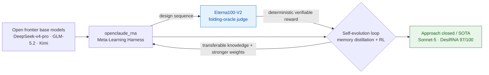
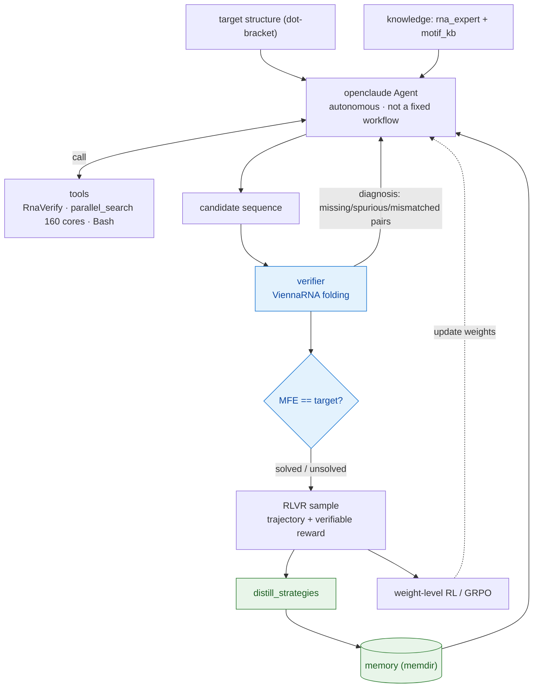
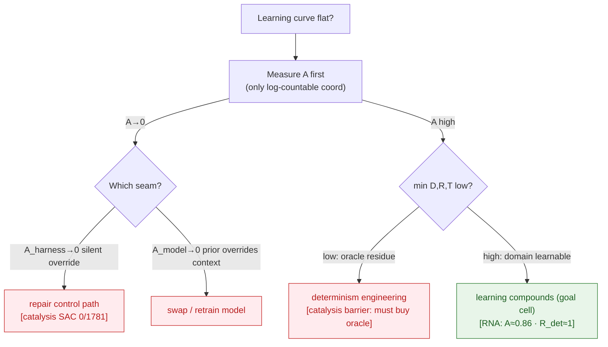

# openclaude_rna: An RNA Inverse-Design Meta-Learning Harness — Technical Report

**2026-07-03 · Rev. 2026-07-14 (cost-aware cognitive-core iteration) · InceptLabs · Judge: ViennaRNA 2.7.2 (Turner2004, 37 °C, dangles=2)**
*Language: **English** · [中文](TECH_REPORT_zh.md)*

> **Reading guide**: §0–§4 are the founding framework + theory (2026-07-03, still current). §5–§8 (2026-07-14) add the iteration since: the cost-to-solve reframe, the domain-agnostic cognitive core, the verifier-as-declarable-predicate, and this iteration's results.

> **Red line**: throughout this report, "success / solved" means **design-correct under the folding oracle only** (the designed sequence's MFE structure == the target dot-bracket). It does **not** imply any in-vivo function or expression.

## Project Philosophy & Goal

**End goal**: a general RNA inverse-design agent. What Claude Code is for people who cannot code, this is for RNA inverse design — hand it a target structure, get back a correct sequence, no expertise required.

**Path — two stages of self-improvement:**

- **Stage 1 · Push meta-learning to its limit.** The agent explores and solves each Eterna100-V2 puzzle using openclaude's **full Claude-Code-class capabilities** (tools, code execution, memory, MCP) in a self-loop that distills every trace into transferable strategy. We drive *inference-time* meta-learning to the ceiling a **fixed** model can reach. The **verifier is the deterministic folding oracle**; mature inverse-design algorithms (e.g. DesiRNA) define the target/ceiling to match or beat. We then **generalize from the fixed 100 puzzles to any open RNA target** (mature algorithms certify designability and generate open tasks). Closing this loop yields an agent adapted to arbitrary RNA inverse-design problems — useful to non-experts, the way Claude Code is.
- **Stage 2 · Raise the base model.** Every trace is collected as agentic RLVR data. Once meta-learning **saturates against the model's ceiling**, we use that data for on-policy RL (GRPO) to train a **stronger base model** — the same ceiling-lifting progression as opus 4.1 → 4.6/4.7/4.8.

**Why RNA makes this tractable** (see Part 3): the folding oracle is free, exact, and self-checkable → R_det ≈ 1 (no oracle residue) and A is high (loop closed), so self-improvement can actually **compound** — the precondition catalysis lacked. Success is measured by **generalization to open problems and usefulness to non-experts**, not by an Eterna100 score alone.

## Abstract

We specialize the general coding agent openclaude into an **RNA inverse-design solver** and layer on a **cross-task self-improvement (meta-learning) layer**. The goal is not to pick the strongest static model, but to **drive open frontier models, via a self-evolution loop (memory distillation + RL), toward closed-model / SOTA parity**. Three **memory-free** base-model runs on Eterna100-V2: **GLM-5.2 56 · Sonnet-5 51 · DeepSeek-v4-pro 47** (/100). **90–98 % of failures are 1500 s wall-clock timeouts**, rooted in classical search failing to converge on hard long structures — **not model reasoning, not tool selection**. Theoretically, the framework absorbs two InceptLabs papers and argues that **RNA-under-ViennaRNA is a positive control that simultaneously clears both of their obstacles**: R_det ≈ 1 (no oracle residue), measured **A ≈ 0.86** (loop closed), and its residual bottleneck (search) is of the **amortizable** kind.

## 0. Overview

**Self-evolution loop (the mission)** — a deterministic judge supplies verifiable reward, driving open models to bootstrap toward SOTA:



**Per-task inner loop (diagnosis-driven repair) + cross-task outer loop (distillation / RL):**



---

# 1 · Framework

**Problem**: given a target secondary structure + constraints (GC window / fixed motif / forbidden subsequence), design a sequence over {A,C,G,U} whose ViennaRNA MFE == the target. `solved` = MFE string equals target; `uMFE` = target is the unique MFE (stricter).

**Layers (open-ended and autonomous, not a fixed workflow):**

| Layer | File | Role |
|---|---|---|
| Judge | `verifier.py` | Deterministic folding oracle + multi-energy-model agreement; emits **per-position diagnosis**; cannot be gamed |
| Agent | `agent_runner.py` | Drives openclaude over OpenRouter; **swap models by changing only `OPENAI_MODEL`**; auto-enables reasoning for OpenRouter; each task = one agentic RLVR sample |
| Tools (MCP) | `mcp/` | Knowledge: `motif_kb` (tetraloop tables / by-loop-length recommendation / structure analysis); compute: `parallel_search` (multi-restart SA, fan-out ≤ **160 cores**), `batch_fold` (clean subprocess to avoid deadlock); native `RnaVerify/Fold/Diagnose/Constraints` |
| Memory | `meta/` | Native memdir; distills **checkable** strategies from solved tasks (`hairpin_motif` / `gc_closing`) → supports A_memory; externalized text rules, **transferable across models** (stored in `memory_library/`) |
| Dashboard | `dashboard/` | Self-contained SVG; **live scoreboard** for in-progress runs (scan traces → oracle scores on the fly, 20 s auto-refresh) |

**Metrics = a four-coordinate diagnostic system** (adopted from the two papers; the first three are domain preconditions, the fourth is a system property):

| Coordinate | Meaning | RNA value |
|---|---|---|
| **D_sym** data purity | Is what we learn the thing itself? | ≈ 1 (dot-bracket is a reproducible symbol) |
| **R_det** reward determinism | Is the criterion unambiguous and non-drifting? | ≈ 1 (MFE == target: deterministic, exact) |
| **T_trace** trace fidelity | Is failure attributable to a step? | ≈ 1 (per-position diagnosis) |
| **A** actuation fidelity | Does a correct diagnosis actually control the next step? | **measured 0.85–0.86** |

A = A_harness × A_model; A_memory is the cross-task version of A. All four high → the **"learning compounds (goal cell)"** of Paper 1 (see §3).

---

# 2 · Three-base-model comparison (Eterna100-V2)

**Setup**: identical config for all three, `--n-tasks 100 --max-len 400 --timeout-s 1500 --workers 3`, **pure base model · no memory · no budget cap**, reasoning on.

| Model | solved | capability | mean_reward | agent_A | mean RNA calls |
|---|---|---|---|---|---|
| **GLM-5.2** | **56** | 58 | 1.21 | 0.86 | 2.61 |
| **Sonnet-5** | 51 | 51 | 1.08 | 0.85 | 4.44 |
| **DeepSeek-v4-pro** | 47 | 47 | 0.93 | 0.86 | 4.36 |

**Failure analysis (300 attempts):**
- **~90–98 % are 1500 s timeouts** (DeepSeek 46/53 · GLM 41/44 · Sonnet 48/49); genuine wrong answers only 1–6; actuation loses almost nothing (delivered ≈ capability).
- **Frontier is 400 nt for all three** → length is not a death sentence; **structural hardness** is. **33 puzzles are unsolved by all three** (nearly all long + all timeouts).
- **Root cause**: on hard long structures classical SA returns `n_solved=0` within 1500 s (e.g. Cesspool 378 nt: 9 `parallel_search` calls, all 0); the model re-invokes it into the wall — **not reasoning, not tool selection**.

**Public SOTA (the target is to beat this, not local self-scores)**: DesiRNA **97** (24 h/puzzle) · NEMO 90 · LLM-SOTA ~79–81 · this framework, bare base models 47–56.

---

# 3 · Theoretical grounding: clearing catalysis's two obstacles

**The two obstacles (the self-improvement failure modes the two InceptLabs papers diagnose):**
- **Obstacle 1 · A→0 (loop unclosed)**: a correct diagnosis is dropped before it controls the next step. Catalysis A_before ≈ **0.095**, SAC **0/1781** (a Stage-4 silent bypass overrode the correct directive).
- **Obstacle 2 · oracle residue**: a physical oracle is expensive / approximate / not self-checkable → R_det has a structural ceiling `α_f + q_f(B)(1−α_f) < 1`. Reaction barriers are a low-α_f, oracle-bound family, flat at fixed budget. *"Capability eats knowledge, not computation."*

| Dimension | Catalysis (failed) | RNA-under-ViennaRNA (this work) |
|---|---|---|
| Oracle nature | DFT/experiment: expensive · approximate · **not self-checkable** | ViennaRNA: near-free · exact · **self-checkable** |
| **R_det** | < 1, has oracle residue | **≈ 1, no residue** (closed/symbolic end) |
| **α_f** | low (oracle-bound) | high (same end as games/code/math) |
| **A_harness** | → 0 (silent override) | **≈ 1** (diagnosis goes straight to the next turn, no silent override) |
| **A (measured)** | 0.095 / SAC 0.00 | **0.85–0.86** |
| Can learning compound? | No (both obstacles hit) | **Yes (both cleared)** |



**Reconciling the 90–98 % timeouts**: these are neither A→0 (A = 0.86) nor oracle residue (R_det ≈ 1); they are a **search-compute** convergence limit on hard long structures. And search is the **amortizable** kind of computation (search → policy, the AlphaZero class) — **exactly what the self-evolution loop is built to eat** — the opposite of catalysis's non-amortizable residue. ⚠️ **Attribution guard** (echoing Oracle Residue §7): the LLM must **internalize better search / decomposition** (genuine learning), *not* merely be given a larger `parallel_search` step count (spending compute + the attribution trap). Clean test: **hold the tool budget fixed, add only experience, and see whether the hard family's solve-rate rises**.

---

# 4 · Progress & advantages: have we cleared the fundamental obstacles?

**Progress**: three memory-free base-model baselines complete; dashboard made live; memory library preserved (playbook support 20/10); framework validated on both determinism and actuation.
**Advantages**: ① model-agnostic (one-line model swap) ② deterministic, self-checkable oracle (R_det ≈ 1) ③ **A is a first-class, measured metric (0.86)** ④ externalized memory, transferable across models ⑤ positive-control positioning — it **disentangles** catalysis's confounded triple ("domain unlearnable / loop unclosed / oracle residue").

**Have we cleared them — an honest reading:**

| Fundamental obstacle (the two papers) | Status | Evidence / framing |
|---|---|---|
| Obstacle 2: oracle residue (R_det < 1) | **Structurally sidestepped** | Chose a free·exact·self-checkable folding oracle → R_det ≈ 1; not "solved the residue" but **chosen a domain where it does not bind** |
| Obstacle 1 · harness seam (A_harness→0) | **Cleared (measured)** | No silent override; **A ≈ 0.86**, two orders of magnitude above catalysis; A is a first-class metric |
| Obstacle 1 · model seam (A_model < 1) | **Partial** | A ≈ 0.86 → ~14 % of correct diagnoses still not adopted |
| Does the self-improvement curve actually rise (compound)? | **Not yet demonstrated** | All three runs are no-memory baselines; A_memory and multi-epoch lift remain to be run |

**In one line**: the two **structural preconditions** are cleared (R_det ≈ 1 by domain choice; A ≈ 0.86 by loop closure + instrumentation), placing us in the **only cell where learning can compound** — but that it **does compound** is not yet shown. **We have crossed "able to learn"; we have not yet proven "is learning"** — which is exactly what the next experiment targets.

> **Red line, restated**: all of the above holds only under the folding oracle. The moment in-vivo function is the target, the physical oracle and its residue return, and Obstacle 2's ceiling reapplies.

---

# 5 · Update 2026-07-14 — from wall-timeouts to cost-to-solve

Two methodology corrections that supersede §2's failure framing:

1. **Do not cap time and mislabel it.** §2 read 90–98 % of failures as "1500 s timeouts." That wall was an *imposed budget*, not a property of the problem. Correction (now a first principle): give the solver **open time and RECORD the cost**. A run is described by its **cost-to-solution**, never by the cap it was cut off at.
2. **One currency for every kind of solver.** Economics is controlled by consumption, not by a stopwatch: **classical solver = CPU-seconds** (`cores × wall × rate`), **LLM = tokens** (`in·p_in + out·p_out`). Both map to USD on one axis, so heterogeneous tools become comparable and routable. Component: [`cognitive/cost.py`](../rna_harness/cognitive/cost.py) (`solver_cost_usd`, `llm_cost_usd`; rates env-overridable, only the relative scale matters).

This reframes the mission's residual bottleneck: not "how do we beat a 1500 s wall" but **"what is the cheapest path to a verified solution, and does experience make that path cheaper."**

---

# 6 · The cost-aware cognitive core (domain-agnostic orchestration)

The scarce capability is **not a better solver** — DesiRNA already reaches Eterna100-V2 **97/100** at 24 h/puzzle. It is the **meta-process** a human expert brings: read a problem, gauge its difficulty/boundary, pick the cheapest tool+budget likely to work, invoke, verify, escalate on failure — solving **any** problem at the **lowest cost**. Domain knowledge lives entirely in the TOOLS; the core is domain-agnostic ML engineering — a learned routing **procedure** (A_θ), not memorized answers (K_θ).

```
features (mechanical, zero biology)  →  router (cost-min, learned)  →  tool.attempt
     →  verify (correct oracle)  →  escalate on failure, accumulating COST
```

| Component | File | Role |
|---|---|---|
| Features | `cognitive/features.py` | 15 mechanical structural features (len, pairs, pseudoknot, junctions, stems, lonely pairs, nesting…); **zero biology**, pseudoknot-robust |
| Tools | `cognitive/tools.py` | Uniform `Tool.attempt → ToolResult` carrying **cost + oracle-verified `solved`**. Toolbox = 3× our REMC (`anneal.py`, cheap) + 2× **DesiRNA** (SOTA subprocess). **DesiRNA is a tool, not the core** |
| Router | `cognitive/router.py` | Cold-start = ascending nominal cost; **learned** = k-NN over standardized features → order by `eff = cost / P(solve)`. Only **reorders** the toolbox, never drops → **solves invariant, cost varies** |
| Core | `cognitive/core.py` | analyse → route → invoke → verify → escalate; records every outcome so the router learns. `FixedPolicy` = the baselines it must beat |
| Evaluate | `cognitive/evaluate.py` | cost-at-quality: cognitive vs `always_cheap` vs `always_sota` |

**DesiRNA is called, not reimplemented**: a subprocess to the real `/data/wenhui/DesiRNA/DesiRNA.py` (`-p 2004` param-aligned), its output re-verified by our oracle. (`anneal.py`'s replica-exchange MC is **our own** reimplementation — a distinct cheap tool, not DesiRNA.)

**Falsifiable bar**: beat fixed policies on cost-at-quality **and** show learning trims wasted cheap attempts on hard puzzles. If it degenerates to "always SOTA at max budget" it is a **wrapper, not a core**.

---

# 7 · The verifier: a declarable decidable predicate (three axes)

`solved` is only as trustworthy as the verifier, so it is a first-class, **solver-independent** stage ([`cognitive/tools.py::verify`](../rna_harness/cognitive/tools.py)). There is **no absolute physical oracle** here; the **formal** truth value is the value of a **decidable predicate** obtained by **evaluation** — fold once, compare — exactly as a SAT assignment's truth is `φ(x)` evaluated. *The model IS the specification*, so within it the truth is absolute, reproducible, and **cheap to check yet expensive to find** (the verify ≠ solve asymmetry the whole core exploits). Two invariants: **proposer ≠ judge** (every candidate — including DesiRNA's own "solved" — is re-folded) and **`solved` never means physical/biological truth** (the red line).

Open-boundary solving = navigating **three axes**, all seated in `verify` (not merely "harder search"):

| Axis | Choice | Mechanism | Concrete example |
|---|---|---|---|
| **1 · which oracle** | nested → ViennaRNA MFE ; pseudoknot → pKiss | `has_pseudoknot(target)` routing | MFE on a pseudoknot is a *category error* — it cannot emit `[`, so `fold==T_pk` is never True; the 29 % false-positive source |
| **2 · how strict** | `match` / `umfe` / `pfe` (declarable, env-tunable) | new `strictness` param | `GGGGGGAAUUUCUC` on `(((((....)))))`: `match`=True but P(T)=0.19 → `pfe`=False (a fragile 1-of-many) |
| **3 · no oracle** | abstain | `oracle="none"` | a *functional* spec ("binds theophylline") has no computable predicate → refuse to claim solved |

This iteration made **axis 2 a declared contract** — `verify(seq, target, strictness=…)` — rather than a constant hidden in code (`match` stays the default, so all prior results are unchanged). Routing the **verifier** itself (oracle + strictness), not just solvers, is the next build; Track B forces it.

---

# 8 · Results this iteration

**Search line (honest record):**
- **Structural retrieval / warm-start (AlphaFold-1 analogy): NULL.** Per-instance-optimal retrieved units compose *worse* than composition-robust generic GC-stiff priors (the uniformity trap). Fair aggregate over n = 28.
- **Single-trajectory guided search: FAILED** (lost to multi-restart hillclimb). Pivoted away from bespoke from-scratch search.
- **Replica-exchange MC (`anneal.py`): the bounded workhorse** — one unified fold-call + wall budget, escapes local minima; now our cheap tier.

**DesiRNA orchestration (cost-recorded, no mislabeled cap):** base agent 58 → **81–83** → **86**; public SOTA 97 (24 h). The earlier "6 walls" was a **budget artifact** (1–3 min DesiRNA = its fast regime); at longer budget most of the residual falls — **true walls ≈ 3**.

**Cost-at-quality (`cogeval`, 18-puzzle mix; cost in USD):**

| Policy | solved | total $ | $/solve |
|---|---|---|---|
| **cognitive** | **18/18** | **0.269** | 0.015 |
| always_cheap (REMC only) | 11/18 | 0.212 | 0.019 |
| always_sota (DesiRNA only) | 17/18 | 0.464 | 0.027 |

The cognitive core **strictly dominates** always-SOTA — **+1 solve and 1.72× cheaper** — by solving the easy majority on the cheap tier and paying for DesiRNA only when forced (11 easy puzzles never touch DesiRNA). This clears the *low* bar (cheap-first cascade beats always-SOTA on an easy-heavy mix).

**Learning vs no-learning (the *meaningful* bar — running):** a controlled fixed-table simulation. Build a (puzzle × tool) → (solved, cost) table **once**, then simulate `cold` cascade vs `learn`ed-router ordering on the **same** table, so the only variable is tool order (no tool-stochasticity / CPU-contention confound). Because the router only reorders (never drops a tool), **solves are identical by construction** — learning can change only cost. Claim: learning cuts total cost by routing predicted-hard puzzles **past the doomed cheap tier**, with the saving concentrated on hard puzzles. `experiments/learning_vs_cold.py`; **results pending table completion** (to be appended).

**Known limitation (recorded honestly):** REMC's wall bound is *soft* (checked once per epoch → a long epoch can overshoot, e.g. remc@120 → ~590 s). Cost accounting stays honest (it records the *real* wall), and the learning-vs-cold **delta** is robust to it because both arms share one table.

---

# Next steps

1. **Finish learning-vs-no-learning** — the core-vs-wrapper judge: report the $ saved and confirm it concentrates on hard puzzles.
2. **Track B — open domain under a switched oracle**: run the same core on RNAInvBench pseudoknots (pKiss verifier); test whether it recognises out-of-model, switches oracle, and stays economical under the expensive verifier.
3. **Verifier as a routed first-class object**: let the core select oracle + strictness (axes 1–2), not only solvers.
4. **(Stage-1 line continues)**: distill experience over solved tasks → refresh `memory_library`; attack the hard-core residual under the **fixed-tool-budget attribution guard** ("LLM orchestration got stronger", not "the tool got bigger"); close the memory/RL loop (A_memory, multi-epoch, GRPO); measure cross-model memory transfer.

# Appendix · Reproduce

```bash
# --- Stage-1 meta-learning agent (baselines) ---
python -m rna_harness.experiments.agent_runner \
  --model z-ai/glm-5.2 --n-tasks 100 --max-len 400 --timeout-s 1500 --workers 3 \
  --out rna_harness/runs/<name>
# env: CLAUDE_CODE_USE_OPENAI=1 · OPENAI_BASE_URL=…/openrouter/api/v1 · OPENAI_API_KEY=<key> · RNA_MAX_CORES=160
# view: http://<host>:8811/report/<name>

# --- Cognitive core (cost-aware routing) ---
export DESIRNA_CMD="/home/ubuntu/miniconda3/envs/rna/bin/python /data/wenhui/DesiRNA/DesiRNA.py"
python -m rna_harness.cognitive.evaluate --ids 8 1 45 59 66 57 72 \
  --policies cognitive always_cheap always_sota      # cost-at-quality
python -m rna_harness.experiments.learning_vs_cold --build   # build the fixed outcome table (once)
python -m rna_harness.experiments.learning_vs_cold --sim     # simulate cold vs learn on it
```

**Key paths**: `agent_runner.py` (Stage-1 driver) · `verifier.py` / `cognitive/tools.py::verify` (judge) · `cognitive/` (cost-aware core) · `experiments/anneal.py` (our REMC) · `generators/desirna.py` (DesiRNA adapter) · `mcp/` · `meta/` · `dashboard/` · `memory_library/`.
**References**: Chen, W. *Actuation Fidelity* (InceptLabs, 2026); Chen, W. & Li, Z. *The Oracle Residue Thesis* (InceptLabs, 2026).
