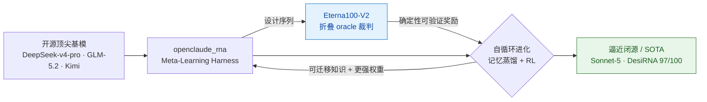
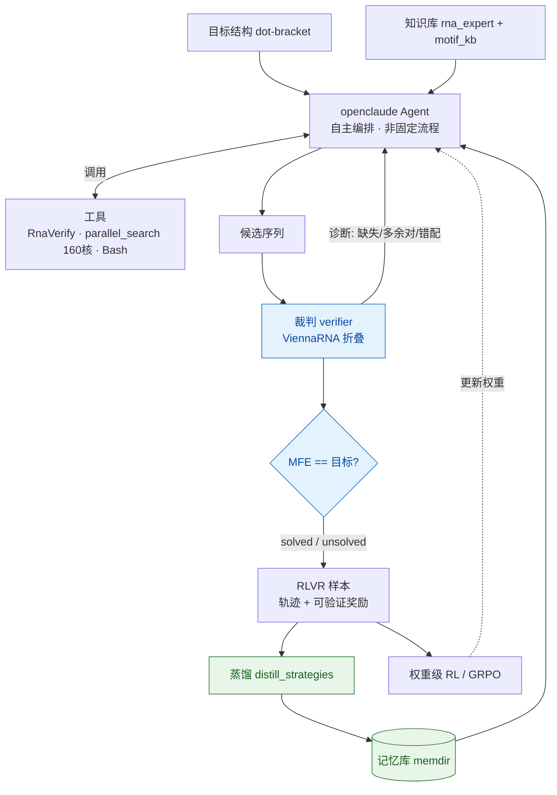
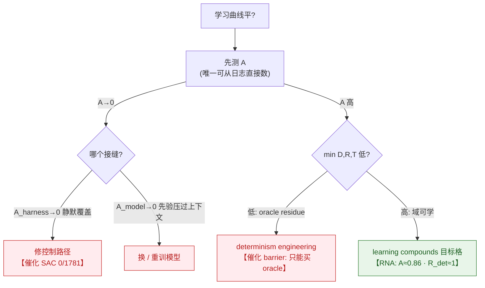

# openclaude_rna:RNA 逆设计 Meta-Learning Harness — 技术报告

**2026-07-03 · Rev. 2026-07-14(成本感知认知核迭代)· InceptLabs · 裁判 ViennaRNA 2.7.2 (Turner2004, 37°C, dangles=2)**
*语言:[English](TECH_REPORT.md) · **中文***

> **阅读指引**:§0–§4 是奠基框架 + 理论(2026-07-03,仍然有效);§5–§8(2026-07-14)追加此后的迭代:成本(cost-to-solve)重构、域无关认知核、verifier 即可声明谓词、以及本轮结果。

> **红线**:全文「成功 / 解出」仅指**折叠 oracle 下设计正确**(设计序列 MFE 结构 == 目标点括号),**不代表 in-vivo 功能或表达**。

## 项目哲学与目标

**终极目标**:一个通用的 RNA 逆设计 agent。Claude Code 让不会写代码的人也能完成代码项目;这个 agent 让不懂 RNA 的人也能直接、正确地做 RNA 逆设计——给它一个目标结构,拿回一条能折对的序列,无需专业背景。

**路径 —— 自我改进的两个阶段:**

- **阶段一 · 把 meta-learning 推到极限。** agent 用 openclaude 的**全部类 Claude-Code 能力**(工具、代码执行、记忆、MCP)自主探索并解答每一道 Eterna100-V2,自循环把每条 trace 蒸馏成可迁移策略。我们把**推理期**元学习推到**固定模型**能达到的天花板。**verifier = 确定性折叠 oracle**;成熟逆设计算法(如 DesiRNA)界定要追平 / 超越的目标与上限。随后**从固定的 100 题泛化到任意开放 RNA 目标**(成熟算法确认可设计性、生成开放题)。闭环一段时间 → 得到一个适应任意 RNA 逆设计的强 agent,像 Claude Code 一样对非专家可用。
- **阶段二 · 抬升基础模型。** 每条 trace 都作为 agentic RLVR 数据收集。当元学习**逼近模型能力天花板而饱和**时,用这些数据做 on-policy RL(GRPO),训练**更强的基础模型** —— 与 opus 4.1 → 4.6/4.7/4.8 同样的抬顶过程。

**为什么 RNA 让这条路可行**(见第三部分):折叠 oracle 免费、精确、可自检 → R_det≈1(无 oracle 残差)、A 高(环已闭),所以自改进**真能 compound** —— 这正是催化所缺的前提。成功以**对开放题的泛化 + 对非专家的可用性**衡量,而非单看 Eterna100 分数。

## 摘要

把通用编码智能体 openclaude 专化为 **RNA 逆设计求解器**,叠加**跨题自改进的元学习层**。目标不是挑最强静态模型,而是**驱动开源顶尖模型经自循环进化(记忆蒸馏 + RL)逼近闭源 / SOTA**。三基模**无记忆**对照(Eterna100-V2):**GLM-5.2 56 · Sonnet-5 51 · DeepSeek-v4-pro 47**(/100)。失败 **90–98% 是 1500s 超时**,根因是经典搜索在难长结构不收敛——**非模型推理、非工具选择**。理论上本框架吸收 InceptLabs 两篇论文,论证 **RNA-under-ViennaRNA 是同时避开其两道坎的 positive control**:R_det≈1(无 oracle 残差)、实测 **A≈0.86**(环已闭)、残余瓶颈(搜索)属**可 amortize**那一类。

## 0. 全景

**自进化闭环(使命)** — 确定性裁判提供可验证奖励,驱动开源模型自举向 SOTA:



**单题内环(诊断驱动修复)+ 跨题外环(蒸馏 / RL)**:



---

# 1 · 框架

**问题**:给定目标二级结构 + 约束(GC 窗口 / 固定 motif / 禁用子序列),设计 {A,C,G,U} 序列使 ViennaRNA MFE == 目标。`solved` = MFE 串等目标;`uMFE` = 唯一 MFE(更严)。

**分层(开放式自主,非固定 workflow):**

| 层 | 文件 | 作用 |
|---|---|---|
| 裁判 | `verifier.py` | 确定性折叠 oracle + 多能量模型一致性;给**逐位诊断**;不可 game |
| Agent | `agent_runner.py` | 驱动 openclaude 走 OpenRouter,**换模型只改 `OPENAI_MODEL`**;对 openrouter 自动开 reasoning;每题 = 一条 agentic RLVR 样本 |
| 工具(MCP)| `mcp/` | 知识:`motif_kb`(tetraloop 表 / 按环长推荐 / 结构分析);计算:`parallel_search`(多重启 SA,fan-out ≤ **160 核**)、`batch_fold`(干净子进程防死锁);原生 `RnaVerify/Fold/Diagnose/Constraints` |
| 记忆 | `meta/` | 原生 memdir;从解出题蒸馏**可检验**策略(`hairpin_motif` / `gc_closing`)→ 支撑 A_memory;外化文字规则,**跨模型可迁移**(存 `memory_library/`)|
| 可视化 | `dashboard/` | 自包含 SVG;进行中 run **实时战绩板**(扫 traces → oracle 现算,20s 自刷)|

**指标 = 四坐标诊断系统**(采自两篇论文;前三是域前提,第四是系统属性):

| 坐标 | 含义 | RNA 取值 |
|---|---|---|
| **D_sym** 数据纯度 | 学的是事物本身? | ≈1(dot-bracket 是可复现符号)|
| **R_det** 奖励确定性 | 判据无歧义、不漂移? | ≈1(MFE==目标,确定精确)|
| **T_trace** 轨迹保真 | 失败可归因到某步? | ≈1(逐位诊断)|
| **A** actuation fidelity | 正确诊断真控制了下一步? | **实测 0.85–0.86** |

A = A_harness × A_model;A_memory = A 的跨题版。四坐标全高 → 落 Paper 1 的 **"learning compounds(目标格)"**(详见 §3)。

---

# 2 · 三基模对照(Eterna100-V2)

**设置**:三模型同配置 `--n-tasks 100 --max-len 400 --timeout-s 1500 --workers 3`,**纯基模 · 无记忆 · 无预算封顶**,reasoning 开。

| 模型 | solved | capability | mean_reward | agent_A | mean RNA calls |
|---|---|---|---|---|---|
| **GLM-5.2** | **56** | 58 | 1.21 | 0.86 | 2.61 |
| **Sonnet-5** | 51 | 51 | 1.08 | 0.85 | 4.44 |
| **DeepSeek-v4-pro** | 47 | 47 | 0.93 | 0.86 | 4.36 |

**失败分析(300 次尝试)**:
- **~90–98% 是 1500s 超时**(DeepSeek 46/53 · GLM 41/44 · Sonnet 48/49);答错仅 1–6;actuation 几乎不丢分(delivered ≈ capability)。
- **frontier 均 400nt** → 长度非死刑,**结构硬度**才是。**硬核 33 题被三家全灭**(几乎全长题 + 全超时)。
- **根因**:难长结构上经典 SA 在 1500s 内 `n_solved=0`(如 Cesspool 378nt:9 次 `parallel_search` 全 0),模型反复重调撞墙——**非推理、非工具选择**。

**公开 SOTA(目标是超越它,非自测)**:DesiRNA **97**(24h/题)· NEMO 90 · LLM-SOTA ~79–81 · 本框架裸基模 47–56。

---

# 3 · 理论根基:跨过催化的两道坎

**两道坎(InceptLabs 两篇论文诊断的自改进死因):**
- **坎一 · A→0(环未闭)**:正确诊断在控制下一步前被丢弃。催化 A_before≈**0.095**、SAC **0/1781**(Stage-4 静默 bypass 覆盖正确指令)。
- **坎二 · oracle 残差**:物理 oracle 昂贵 / 近似 / 不可自检 → R_det 有结构天花板 `α_f + q_f(B)(1−α_f) < 1`。反应势垒是低-α_f、oracle-bound 家族,固定预算下必平。「**capability eats knowledge, not computation**」。

| 维度 | 催化(踩坑)| RNA-under-ViennaRNA(本框架)|
|---|---|---|
| 裁判性质 | DFT/实验:昂贵·近似·**不可自检** | ViennaRNA:近 free · exact · **可自检** |
| **R_det** | <1,有 oracle 残差 | **≈1,无残差**(closed/symbolic 端)|
| **α_f** | 低(oracle-bound)| 高(games/code/math 同端)|
| **A_harness** | →0(静默覆盖)| **≈1**(诊断直达下一轮,无静默 override)|
| **A(实测)** | 0.095 / SAC 0.00 | **0.85–0.86** |
| 学习能 compound? | 否(两坎皆中)| **是(两坎皆避)** |



**90–98% 超时的对账**:既非 A→0(A=0.86)、也非残差(R_det≈1),而是**搜索算力**在硬长结构的收敛限。而搜索是**可 amortize**的(search→policy,AlphaZero 那类),**正是自进化能吃掉的一类**——与催化那种「买不回」的残差相反。⚠️ **归因守则**(呼应 Oracle Residue §7):须让 **LLM 内化更好的搜索 / 分治**(真学习),而非只把 `parallel_search` 步数调大(花算力 + 归因陷阱)。判据:**固定工具预算、只加经验,看硬家族 solve-rate 是否升**。

---

# 4 · 进展与优势:跨过根本障碍了吗?

**进展**:三基模无记忆基线完成;dashboard 实时化;记忆库保全(playbook support 20/10);框架经确定性 + actuation 双重验证。
**优势**:① 模型无关(一键换基模)② 确定性可自检 oracle(R_det≈1)③ **A 一等可测(0.86)** ④ 记忆外化、跨模型可迁移 ⑤ positive-control 定位——把催化里「域不可学 / 环未闭 / oracle 残差」三重混淆**拆干净**。

**跨过了吗 —— 诚实判读:**

| 根本障碍(两篇论文)| 状态 | 证据 / 口径 |
|---|---|---|
| 坎二:oracle 残差(R_det<1)| **结构性绕过** | 选 free·exact·self-checkable 折叠 oracle → R_det≈1;非「解决残差」,而是**选在残差不 binding 的域** |
| 坎一 · harness 接缝(A_harness→0)| **已跨(实测)** | 无静默 override;**A≈0.86**,高催化两个数量级;A 为一等指标 |
| 坎一 · model 接缝(A_model<1)| **部分** | A≈0.86 → 仍 ~14% 正确诊断未被采纳 |
| 自改进曲线真的上升(compound)| **尚未证明** | 三轮均 no-memory 基线;A_memory 与多-epoch 抬升待跑 |

**一句话**:两道**结构性前提**已跨过(R_det≈1 靠选域;A≈0.86 靠闭环 + 仪表化),**落在唯一能 compound 的格**;但「**确实在 compound**」尚未证明。**我们跨过的是「能学」,还没证明「在学」**——那正是下一实验的靶。

> **红线重申**:以上仅在 folding-oracle 意义下成立;一旦要 in-vivo 功能,物理 oracle 及其残差回归,坎二天花板重新生效。

---

# 5 · 更新 2026-07-14 —— 从「墙时间超时」到「解题成本」

两条方法论纠正,取代 §2 的失败口径:

1. **不要卡时间再贴错标签。** §2 把 90–98% 的失败读作「1500s 超时」。那道墙是**外加的预算**,不是问题本身的属性。纠正(现为第一性原则):给求解器**开放时间,并记录成本**。一次 run 用**解题成本(cost-to-solution)**刻画,绝不用被砍断的封顶来描述。
2. **一切求解器同一种货币。** 经济由**消耗**控制,不由秒表控制:**经典求解器 = CPU 秒**(`核数 × 墙 × 费率`),**LLM = token**(`in·p_in + out·p_out`)。两者映到同一条 USD 轴,异质工具因此可比、可路由。组件:[`cognitive/cost.py`](../rna_harness/cognitive/cost.py)(`solver_cost_usd`、`llm_cost_usd`;费率可用环境变量覆盖,只有相对尺度要紧)。

这把使命的残余瓶颈重构了:不再是「怎么翻过 1500s 的墙」,而是**「到达一个被验证的解,最便宜的路径是什么;经验能否让这条路径更便宜」**。

---

# 6 · 成本感知认知核(域无关的工具编排)

稀缺的能力**不是更强的求解器**—— DesiRNA 已在 Eterna100-V2 达 **97/100**(24h/题)。稀缺的是人类专家带来的**元过程**:读题、判难度/边界、挑一个最可能奏效且最便宜的工具 + 预算、调用、验证、失败即升级——用**最低成本**解**任意**问题。领域知识全部住在**工具**里;核是域无关的 ML 工程——一套学到的路由**过程**(A_θ),不是背下来的答案(K_θ)。

```
特征(机械、零生物)  →  router(成本最小、可学)  →  tool.attempt
     →  verify(正确 oracle)  →  失败则升级,一路累计成本
```

| 组件 | 文件 | 作用 |
|---|---|---|
| 特征 | `cognitive/features.py` | 15 个机械结构特征(长度、对数、假结、junction、茎、孤立对、嵌套深度…);**零生物**,假结鲁棒 |
| 工具 | `cognitive/tools.py` | 统一 `Tool.attempt → ToolResult`,携带**成本 + oracle 校验过的 `solved`**。工具箱 = 3× 自家 REMC(`anneal.py`,便宜)+ 2× **DesiRNA**(SOTA 子进程)。**DesiRNA 是工具,不是核** |
| Router | `cognitive/router.py` | 冷启动 = 标称成本升序;**学习**后 = 标准化特征上的 k-NN → 按 `eff = cost / P(solve)` 排序。只**重排**工具箱、从不删 → **解出数不变、成本变** |
| 核 | `cognitive/core.py` | analyse → route → invoke → verify → escalate;记录每次结果供 router 学习。`FixedPolicy` = 它必须打败的基线 |
| 评测 | `cognitive/evaluate.py` | cost-at-quality:cognitive vs `always_cheap` vs `always_sota` |

**DesiRNA 是被调用,不是被重写**:子进程调真的 `/data/wenhui/DesiRNA/DesiRNA.py`(`-p 2004` 参数对齐),产出一律用我们的 oracle 复验。(`anneal.py` 的副本交换 MC 是**我们自己**的重实现——一件独立的便宜工具,不是 DesiRNA。)

**可证伪门槛**:在 cost-at-quality 上打败固定策略,**并且**证明学习能砍掉难题上白费的便宜尝试。若退化成「永远顶配调 SOTA」,那就是**壳,不是核**。

---

# 7 · verifier:一个可声明的可判定谓词(三条轴)

`solved` 的可信度不超过 verifier,所以它是一等的、**与求解器解耦**的阶段([`cognitive/tools.py::verify`](../rna_harness/cognitive/tools.py))。这里**没有绝对的物理 oracle**;**形式**真值 = 一个**可判定谓词**经**求值**得到的取值——折一次、比一次——正如 SAT 赋值的真值就是 `φ(x)` 求值。**模型即规约**,所以在模型内真值是绝对、可复现、且**验证便宜而求解昂贵**的(verify ≠ solve 的不对称,正是整个核吃的那口饭)。两条不变量:**出题人 ≠ 判卷人**(每个候选——包括 DesiRNA 自报的「solved」——都被复折)、以及 **`solved` 永不等于物理/生物真相**(红线)。

开放边界解题 = 在**三条轴**上做对选择(不只是「搜得更狠」),三轴都坐落在 `verify`:

| 轴 | 选择 | 机制 | 具体例子 |
|---|---|---|---|
| **1 · 选 oracle** | 嵌套 → ViennaRNA MFE;假结 → pKiss | `has_pseudoknot(target)` 路由 | 拿 MFE 判假结是**范畴错误**——它吐不出 `[`,`fold==T_pk` 永远 False;29% 假阳来源 |
| **2 · 定严格度** | `match` / `umfe` / `pfe`(可声明、可用环境变量调) | 新增 `strictness` 参数 | `GGGGGGAAUUUCUC` 对 `(((((....)))))`:`match`=True 但 P(T)=0.19 → `pfe`=False(脆弱的多解之一) |
| **3 · 无 oracle** | 弃权 | `oracle="none"` | **功能**规约(「结合茶碱」)没有可计算谓词 → 拒绝声称 solved |

本轮把**轴 2 做成了可声明契约**——`verify(seq, target, strictness=…)`,而不是藏在代码里的常量(`match` 仍是默认,故此前所有结果不变)。把 **verifier 本身**(oracle + 严格度)也当被路由对象、而不只路由求解器,是下一步的活;B 轨会逼出它。

---

# 8 · 本轮结果

**搜索线(诚实记录):**
- **结构检索 / warm-start(对标 AlphaFold-1):NULL。** 逐例最优的检索单元,组合起来**不如**组合鲁棒的通用 GC-硬先验(uniformity trap)。n = 28 公平聚合。
- **单轨迹 guided search:失败**(输给多重启爬山)。就此放弃从零定制搜索。
- **副本交换 MC(`anneal.py`):有界主力**——统一的 fold-call + 墙预算,逃局部最优;现为便宜档。

**DesiRNA 编排(记成本、不贴错封顶标签):** 基座 agent 58 → **81–83** → **86**;公开 SOTA 97(24h)。此前的「6 道墙」是**预算假象**(1–3 分钟 DesiRNA = 它的快速档);预算拉长后大部分残余会掉——**真墙 ≈ 3**。

**Cost-at-quality(`cogeval`,18 题混合;成本单位 USD):**

| 策略 | 解出 | 总 $ | $/解 |
|---|---|---|---|
| **cognitive** | **18/18** | **0.269** | 0.015 |
| always_cheap(仅 REMC) | 11/18 | 0.212 | 0.019 |
| always_sota(仅 DesiRNA) | 17/18 | 0.464 | 0.027 |

认知核**严格支配**always-SOTA——**多解 1 题、且便宜 1.72×**——靠便宜档解掉简单的大多数、只在被逼时才为 DesiRNA 付费(11 道易题**根本没碰** DesiRNA)。这跨过了**低**门槛(便宜级联在易题占多数时打败 always-SOTA)。

**learning vs no-learning(**有意义**的门槛——运行中):** 一个受控的固定表模拟。**先建一次**(题 × 工具)→(solved, cost)表,再在**同一张表**上模拟 `cold` 级联 vs `learn` 后的 router 排序,使唯一变量是工具顺序(消除工具随机性 / CPU 争抢噪声)。因为 router 只重排(从不删工具),**解出数按构造完全相同**——学习只能改成本。论点:学习把预测为难的题**绕过注定失败的便宜档**,从而砍成本,省下的钱集中在难题上。`experiments/learning_vs_cold.py`;**结果待建表完成**(将补上)。

**已知局限(诚实记录):** REMC 的墙是**软**的(每 epoch 才查一次 → 单个长 epoch 会超,如 remc@120 → ~590s)。成本记账仍诚实(记的是**真实**墙),且 learning-vs-cold 的**差值**对此鲁棒——两臂共用同一张表。

---

# 下一步

1. **跑完 learning-vs-no-learning** —— 核 vs 壳的判据:报告省下的 $,并确认它集中在难题上。
2. **B 轨 —— 换 oracle 的开放域**:同一个核跑 RNAInvBench 假结(pKiss verifier);检验它能否识别出模型、切换 oracle、并在贵 verifier 下保持经济。
3. **verifier 作为被路由的一等对象**:让核选 oracle + 严格度(轴 1–2),不只选求解器。
4. **(阶段一线继续)**:对解出题蒸馏经验 → 刷新 `memory_library`;在**固定工具预算的归因守则**下攻硬核残余(是「LLM 编排变强」,不是「工具调大了」);闭合记忆/RL 环(A_memory、多-epoch、GRPO);测跨模型记忆迁移。

# 附录 · 复现

```bash
# --- 阶段一 元学习 agent(基线) ---
python -m rna_harness.experiments.agent_runner \
  --model z-ai/glm-5.2 --n-tasks 100 --max-len 400 --timeout-s 1500 --workers 3 \
  --out rna_harness/runs/<name>
# env: CLAUDE_CODE_USE_OPENAI=1 · OPENAI_BASE_URL=…/openrouter/api/v1 · OPENAI_API_KEY=<key> · RNA_MAX_CORES=160
# 看结果: http://<host>:8811/report/<name>

# --- 认知核(成本感知路由) ---
export DESIRNA_CMD="/home/ubuntu/miniconda3/envs/rna/bin/python /data/wenhui/DesiRNA/DesiRNA.py"
python -m rna_harness.cognitive.evaluate --ids 8 1 45 59 66 57 72 \
  --policies cognitive always_cheap always_sota      # cost-at-quality
python -m rna_harness.experiments.learning_vs_cold --build   # 建固定结果表(一次)
python -m rna_harness.experiments.learning_vs_cold --sim     # 在表上模拟 cold vs learn
```

**关键路径**:`agent_runner.py`(阶段一驱动)· `verifier.py` / `cognitive/tools.py::verify`(裁判)· `cognitive/`(成本感知核)· `experiments/anneal.py`(自家 REMC)· `generators/desirna.py`(DesiRNA 适配器)· `mcp/` · `meta/` · `dashboard/` · `memory_library/`。
**引用**:Chen, W. *Actuation Fidelity* (InceptLabs 2026);Chen, W. & Li, Z. *The Oracle Residue Thesis* (InceptLabs 2026)。
