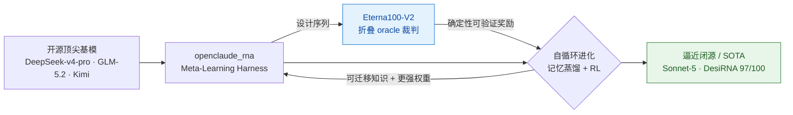
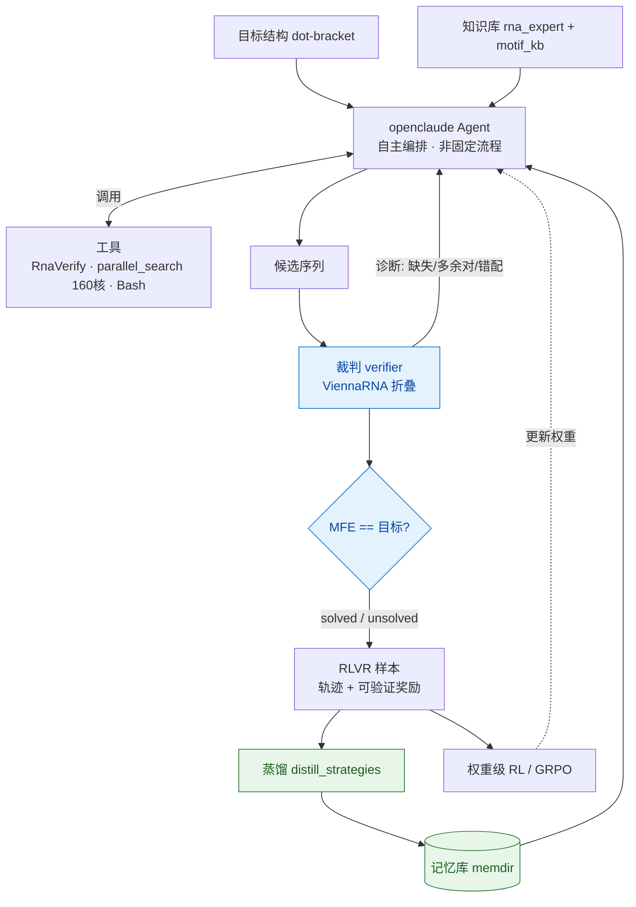
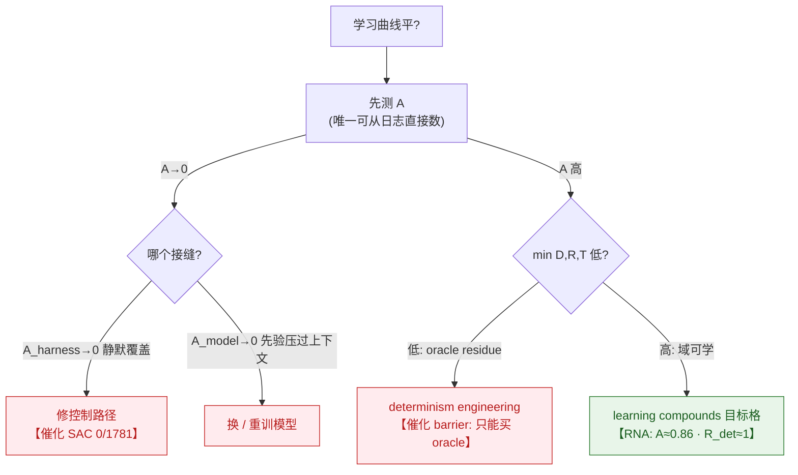

# openclaude_rna:RNA 逆设计 Meta-Learning Harness — 技术报告

**2026-07-03 · InceptLabs · 裁判 ViennaRNA 2.7.2 (Turner2004, 37°C, dangles=2)**
*语言:[English](TECH_REPORT.md) · **中文***

> **红线**:全文「成功 / 解出」仅指**折叠 oracle 下设计正确**(设计序列 MFE 结构 == 目标点括号),**不代表 in-vivo 功能或表达**。

## 摘要

把通用编码智能体 openclaude 专化为 **RNA 逆设计求解器**,叠加**跨题自改进的元学习层**。目标不是挑最强静态模型,而是**驱动开源顶尖模型经自循环进化(记忆蒸馏 + RL)逼近闭源 / SOTA**。三基模**无记忆**对照(Eterna100-V2):**GLM-5.2 56 · Sonnet-5 51 · DeepSeek-v4-pro 47**(/100)。失败 **90–98% 是 1500s 超时**,根因是经典搜索在难长结构不收敛——**非模型推理、非工具选择**。理论上本框架吸收 InceptLabs 两篇论文,论证 **RNA-under-ViennaRNA 是同时避开其两道坎的 positive control**:R_det≈1(无 oracle 残差)、实测 **A≈0.86**(环已闭)、残余瓶颈(搜索)属**可 amortize**那一类。

## 0. 全景

**自进化闭环(使命)** — 确定性裁判提供可验证奖励,驱动开源模型自举向 SOTA:



**单题内环(诊断驱动修复)+ 跨题外环(蒸馏 / RL)**:



---

# 1 · 框架

**问题**:给定目标二级结构 + 约束(GC 窗口 / 固定 motif / 禁用子序列),设计 {A,C,G,U} 序列使 ViennaRNA MFE == 目标。`solved` = MFE 串等目标;`uMFE` = 唯一 MFE(更严)。

**分层(开放式自主,非固定 workflow):**

| 层 | 文件 | 作用 |
|---|---|---|
| 裁判 | `verifier.py` | 确定性折叠 oracle + 多能量模型一致性;给**逐位诊断**;不可 game |
| Agent | `agent_runner.py` | 驱动 openclaude 走 OpenRouter,**换模型只改 `OPENAI_MODEL`**;对 openrouter 自动开 reasoning;每题 = 一条 agentic RLVR 样本 |
| 工具(MCP)| `mcp/` | 知识:`motif_kb`(tetraloop 表 / 按环长推荐 / 结构分析);计算:`parallel_search`(多重启 SA,fan-out ≤ **160 核**)、`batch_fold`(干净子进程防死锁);原生 `RnaVerify/Fold/Diagnose/Constraints` |
| 记忆 | `meta/` | 原生 memdir;从解出题蒸馏**可检验**策略(`hairpin_motif` / `gc_closing`)→ 支撑 A_memory;外化文字规则,**跨模型可迁移**(存 `memory_library/`)|
| 可视化 | `dashboard/` | 自包含 SVG;进行中 run **实时战绩板**(扫 traces → oracle 现算,20s 自刷)|

**指标 = 四坐标诊断系统**(采自两篇论文;前三是域前提,第四是系统属性):

| 坐标 | 含义 | RNA 取值 |
|---|---|---|
| **D_sym** 数据纯度 | 学的是事物本身? | ≈1(dot-bracket 是可复现符号)|
| **R_det** 奖励确定性 | 判据无歧义、不漂移? | ≈1(MFE==目标,确定精确)|
| **T_trace** 轨迹保真 | 失败可归因到某步? | ≈1(逐位诊断)|
| **A** actuation fidelity | 正确诊断真控制了下一步? | **实测 0.85–0.86** |

A = A_harness × A_model;A_memory = A 的跨题版。四坐标全高 → 落 Paper 1 的 **"learning compounds(目标格)"**(详见 §3)。

---

# 2 · 三基模对照(Eterna100-V2)

**设置**:三模型同配置 `--n-tasks 100 --max-len 400 --timeout-s 1500 --workers 3`,**纯基模 · 无记忆 · 无预算封顶**,reasoning 开。

| 模型 | solved | capability | mean_reward | agent_A | mean RNA calls |
|---|---|---|---|---|---|
| **GLM-5.2** | **56** | 58 | 1.21 | 0.86 | 2.61 |
| **Sonnet-5** | 51 | 51 | 1.08 | 0.85 | 4.44 |
| **DeepSeek-v4-pro** | 47 | 47 | 0.93 | 0.86 | 4.36 |

**失败分析(300 次尝试)**:
- **~90–98% 是 1500s 超时**(DeepSeek 46/53 · GLM 41/44 · Sonnet 48/49);答错仅 1–6;actuation 几乎不丢分(delivered ≈ capability)。
- **frontier 均 400nt** → 长度非死刑,**结构硬度**才是。**硬核 33 题被三家全灭**(几乎全长题 + 全超时)。
- **根因**:难长结构上经典 SA 在 1500s 内 `n_solved=0`(如 Cesspool 378nt:9 次 `parallel_search` 全 0),模型反复重调撞墙——**非推理、非工具选择**。

**公开 SOTA(目标是超越它,非自测)**:DesiRNA **97**(24h/题)· NEMO 90 · LLM-SOTA ~79–81 · 本框架裸基模 47–56。

---

# 3 · 理论根基:跨过催化的两道坎

**两道坎(InceptLabs 两篇论文诊断的自改进死因):**
- **坎一 · A→0(环未闭)**:正确诊断在控制下一步前被丢弃。催化 A_before≈**0.095**、SAC **0/1781**(Stage-4 静默 bypass 覆盖正确指令)。
- **坎二 · oracle 残差**:物理 oracle 昂贵 / 近似 / 不可自检 → R_det 有结构天花板 `α_f + q_f(B)(1−α_f) < 1`。反应势垒是低-α_f、oracle-bound 家族,固定预算下必平。「**capability eats knowledge, not computation**」。

| 维度 | 催化(踩坑)| RNA-under-ViennaRNA(本框架)|
|---|---|---|
| 裁判性质 | DFT/实验:昂贵·近似·**不可自检** | ViennaRNA:近 free · exact · **可自检** |
| **R_det** | <1,有 oracle 残差 | **≈1,无残差**(closed/symbolic 端)|
| **α_f** | 低(oracle-bound)| 高(games/code/math 同端)|
| **A_harness** | →0(静默覆盖)| **≈1**(诊断直达下一轮,无静默 override)|
| **A(实测)** | 0.095 / SAC 0.00 | **0.85–0.86** |
| 学习能 compound? | 否(两坎皆中)| **是(两坎皆避)** |



**90–98% 超时的对账**:既非 A→0(A=0.86)、也非残差(R_det≈1),而是**搜索算力**在硬长结构的收敛限。而搜索是**可 amortize**的(search→policy,AlphaZero 那类),**正是自进化能吃掉的一类**——与催化那种「买不回」的残差相反。⚠️ **归因守则**(呼应 Oracle Residue §7):须让 **LLM 内化更好的搜索 / 分治**(真学习),而非只把 `parallel_search` 步数调大(花算力 + 归因陷阱)。判据:**固定工具预算、只加经验,看硬家族 solve-rate 是否升**。

---

# 4 · 进展与优势:跨过根本障碍了吗?

**进展**:三基模无记忆基线完成;dashboard 实时化;记忆库保全(playbook support 20/10);框架经确定性 + actuation 双重验证。
**优势**:① 模型无关(一键换基模)② 确定性可自检 oracle(R_det≈1)③ **A 一等可测(0.86)** ④ 记忆外化、跨模型可迁移 ⑤ positive-control 定位——把催化里「域不可学 / 环未闭 / oracle 残差」三重混淆**拆干净**。

**跨过了吗 —— 诚实判读:**

| 根本障碍(两篇论文)| 状态 | 证据 / 口径 |
|---|---|---|
| 坎二:oracle 残差(R_det<1)| **结构性绕过** | 选 free·exact·self-checkable 折叠 oracle → R_det≈1;非「解决残差」,而是**选在残差不 binding 的域** |
| 坎一 · harness 接缝(A_harness→0)| **已跨(实测)** | 无静默 override;**A≈0.86**,高催化两个数量级;A 为一等指标 |
| 坎一 · model 接缝(A_model<1)| **部分** | A≈0.86 → 仍 ~14% 正确诊断未被采纳 |
| 自改进曲线真的上升(compound)| **尚未证明** | 三轮均 no-memory 基线;A_memory 与多-epoch 抬升待跑 |

**一句话**:两道**结构性前提**已跨过(R_det≈1 靠选域;A≈0.86 靠闭环 + 仪表化),**落在唯一能 compound 的格**;但「**确实在 compound**」尚未证明。**我们跨过的是「能学」,还没证明「在学」**——那正是下一实验的靶。

> **红线重申**:以上仅在 folding-oracle 意义下成立;一旦要 in-vivo 功能,物理 oracle 及其残差回归,坎二天花板重新生效。

---

# 下一步

1. **蒸经验(离线)**:三轮解出题 `distill_strategies` → 刷新 `memory_library`。
2. **攻硬核 33**:强化搜索 + 分治策略,**严格区分「工具变强」vs「LLM 编排变强」**。
3. **自进化闭环**:① 带记忆多-epoch(测 A_memory + 抬升);② 权重级 RL / GRPO。
4. **迁移**:GLM-5.2 无记忆基线 → 带 DeepSeek 蒸馏记忆,测迁移增益。

# 附录 · 复现

```bash
python -m rna_harness.experiments.agent_runner \
  --model z-ai/glm-5.2 --n-tasks 100 --max-len 400 --timeout-s 1500 --workers 3 \
  --out rna_harness/runs/<name>
# env: CLAUDE_CODE_USE_OPENAI=1 · OPENAI_BASE_URL=…/openrouter/api/v1 · OPENAI_API_KEY=<key> · RNA_MAX_CORES=160
# 看结果: http://<host>:8811/report/<name>
```

**关键路径**:`agent_runner.py`(驱动)· `verifier.py`(裁判)· `mcp/`(工具)· `meta/`(记忆)· `dashboard/`(可视化)· `memory_library/`(已学知识)。
**引用**:Chen, W. *Actuation Fidelity* (InceptLabs 2026);Chen, W. & Li, Z. *The Oracle Residue Thesis* (InceptLabs 2026)。
