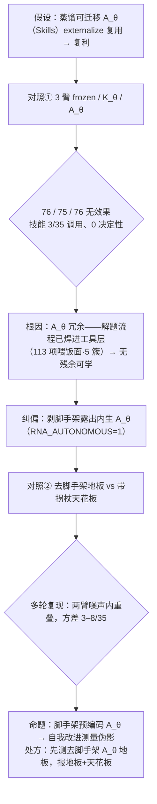
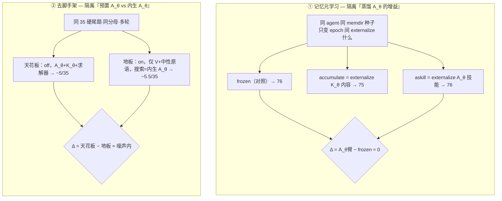

# Meta-Learning AI4S Harness：从经验中蒸馏 A_θ — 周报（2026-07-10）

> **北极星：** 构建面向科学发现的元学习 harness——跨 epoch 蒸馏、经精确验证器 $V$ 门控地累积**可迁移 $A_\theta$**，使 agent 解题**复利**；尤其针对 $K_\theta$（记忆知识）失效的低流形支撑 / schema 级新颖区域。
> **目标实体 = $A_\theta$（Karpathy Cognitive Core 的算法核）：**「从知识中剥离、只保留算法与求解策略」的实体（TECH_REPORT §1.3）。
> **RNA 逆设计（ViennaRNA 精确 oracle）= proof-of-concept：** 科学域里罕见的免费、精确、可自检 $V$（$R_{\det}\approx1$）让「$A_\theta$ 有没有被学到」的测量**只能归因机制、不能赖噪声**。
> **红线：** solved = 折叠 oracle 下设计正确，不做体内声明；只蒸馏策略（$A_\theta$），绝不背答案（$K_\theta$ 序列）。

---

## TL;DR

本周验证「蒸馏 $A_\theta$ → 复利」：**NULL**。根因 = **$A_\theta$ 已被 harness 焊进工具层（冗余）**，externalize 的技能只是复述、无残余可学。要真测 $A_\theta$ 须先**剥脚手架**（`RNA_AUTONOMOUS`）露出 agent 内生 $A_\theta$。本周末多轮复现暴露：招牌数字（地板 3/35 vs 带拐杖 11/35）同口径下**落进噪声**，坐实「单点估计误导、必须多种子多模型」。

---

## 1. 理论框架：Cognitive Core、$A_\theta$ 蒸馏、AI4S 为何靠 $A_\theta$

**模型一次行动**（TECH_REPORT eq 1.1）：$\;a_t \sim \pi_\theta(a_t \mid q,\, C_t,\, K_\theta,\, A_\theta,\, V)$

| 符号 | 名称 | 本项目对应 |
|---|---|---|
| $K_\theta$ | parametric knowledge | 记忆的 motif、答案片段（**红线：不 externalize**） |
| $A_\theta$ | **algorithmic core** | **追求的实体**：分解、逆折叠搜索、诊断-修复策略 |
| $C_t$ | working memory | 目标结构、fold 结果、diagnose 反馈 |
| $V$ | verifier / feedback | ViennaRNA MFE + bp_distance（精确、免费、可自检） |

**AI4S 为何靠 $A_\theta$：** 科学发现 = schema 级新颖 / 低密度 OOD（TECH_REPORT Table 1.1），训练分布支撑极弱 → $K_\theta$ 失效或幻觉，只有 $A_\theta$ 能迁移。所以「less memory，more cognitive core」在此是硬约束，也是选 RNA-精确-$V$ 作显微镜的理由。

**实验 = Cognitive Core 操作化：** 对照① 测 externalize $K_\theta$（内容）vs $A_\theta$（Skills）的增益；对照② 把 harness 预置的 $A_\theta$/$K_\theta$ 剥到只剩 $V$+中性原语，**逼搜索算法成为 agent 自己的 $A_\theta$**（地板=内生，天花板=内生+预置）。

**下一步理论输入（MIT 范畴论 AI4S，arXiv 2606.01444）——只借一个判据：** 它把 retrieval / search / **discovery** 客观分开——discovery = 经 $V$ 验证的 schema 跃迁，即「超出函子式传输的残余内容」。这给 harness 一个 gaming-proof 的「是否真学到 $A_\theta$」接受门，也精确解释了我们的 null（技能=函子式传输、残余=0=非 discovery）。诚实边界：只借判据、不套整套范畴机器；该论文无 meta-learning，与我们互补不撞。

---

## 2. 研究主线（假设→证伪→纠偏）



---

## 3. 对照实验设计（映射 Cognitive Core）



> 两组都**只留单一变量**，其余 agent/种子/题集/分母全部拉齐，使 Δ 可归因。对照②多轮复现是本周新增的严谨度硬化（§5.3）。

---

## 4. 实验计划 vs 进展

| # | 计划 | 状态 | 关键产出 |
|---|---|---|---|
| E1 | 打通 live 记忆召回（memdir → $C_t$） | ✅ 07-04 | sha256 匹配；但 hairpin 太易 → NULL |
| E2 | 记忆表征：$K_\theta$ 均匀 vs 多样（powered） | ✅ 07-06 | 均匀=中性；多样 +0.09 但 n=30 不显著 |
| E3 | $K_\theta$→$A_\theta$ 重构：记忆改为可调用 Skills | ✅ 07-07 | `skill_distiller.py`（红线遮蔽序列/结构） |
| E4 | 对照① 3 臂，4 epoch | ✅ 07-08 | **76/75/76 NULL**；根因 = $A_\theta$ 冗余 |
| E5 | 对照② 去脚手架门控 ~22 处 | ✅ 07-08 | flag-off 字节级不变；flag-on 仅 $V$+中性原语 |
| E6 | 归因：76 分谁解的 | ✅ 07-08 | **56/65 靠自动求解器**（search 非 discovery） |
| E7 | 去脚手架地板多轮复现（硬化） | 🔄 07-09→ | r1/r2 完成，r3 在跑（§5.3） |
| E8 | 下一步理论输入：MIT discovery 判据 | ✅ 07-10 | 借 retrieval/search/discovery 判据 |
| E9 | M3 工具获取 / M4 $A_\theta$ 自优化 | ⏳ 计划中 | 需受控放开网络 / 有能力 subject |

---

## 5. 阶段性结果

### 5.1 对照① 蒸馏 $A_\theta$：**NULL**（E4）

| 臂 | externalize | 解出（/100，基线 65 起） | 技能调用 |
|---|---|---|---|
| frozen | 无（对照） | **76** | — |
| accumulate | $K_\theta$ 内容 | **75** | — |
| askill | $A_\theta$ 技能 | **76** | **3/35，0 决定性** |

n=1/臂、4 epoch、glm-5.2；三臂落在 ±1 内。**根因是 $A_\theta$ 冗余**：`agent_runner` prompt + MCP 工具 docstring 已内联整套 DECOMPOSE→DESIGN→STITCH→REPAIR 剧本，蒸馏的技能只是复述 → 借 MIT 判据是 *search* 的函子式传输、残余=0，非 *discovery*。

### 5.2 归因：76 = LLM 编排经典搜索（E6）

```
65 条基线解 · 获胜序列来源：
  ████████████████████████████████████████████████  56  自动求解器（37 MCP · 16 Bash · 3 自写 SA）
  ███████                                             9  纯手工设计
```
判断/编排内化进 LLM（$A_\theta$ 一部分），搜索计算留在外部经典求解器（$V$ 域内的 search）；RNA 这份外部计算**可摊销**，故域仍允许复利——但目前自我改进停在 search 层，未触及 discovery。

### 5.3 对照② 去脚手架 $A_\theta$ 地板 vs 天花板 —— **诚实信号**（E7，进行中）

原单点估计：地板 3/35 vs 带拐杖 11/35 → 曾据此说「~73% 硬尾能力来自预置 $A_\theta$」。多轮 head-to-head 复现（同题·同分母·glm-5.2）：

```
天花板(带拐杖):  r1 ██████ 6/35   r2 ████ 4/35        均值 ~5.0/35
地板(自主):      r1 ████████ 8/35  r2 ███ 3/35         均值 ~5.5/35   （r3 进行中）
                 └── 噪声内重叠，单轮方差 3–8/35 ──┘
```

⚠️ **招牌数字未重现**（地板 r1=8 > 天花板 r1=6）。含义：① 「73% 靠脚手架」暂不能作定论；② 但更深命题**反被支持**——硬尾上带拐杖 vs 去脚手架**不可区分**，正说明预置 $A_\theta$ 没买到可测能力；③ 框架改为「两臂不可区分 + 方差极大 → 单点估计误导」。

### 5.4 对照① 记忆表征（powered，E2）

n=30 × K=3：no_memory 0.567 / uniform 0.578（Δ+0.011 n.s.）/ diverse 0.656（Δ+0.089 n.s.）；evals-to-solve diverse 3.22 < none 3.82。$K_\theta$ 均匀记忆**中性非有害**（诊断-修复 $A_\theta$ 环吸收了 oracle 级 0/12 误折叠）；多样记忆方向性正但不可证（需 ~120 任务）。信号在**效率**，不在最终 solve。

---

## 6. 离 Eterna100-V2 SOTA 的差距

（deep-research 核实；「90/99」两处误传已纠正：99=V1 Montparnasse，90=削弱预算的 NEMO 基线。）

| 方法 | V2 | 预算 | 类别 |
|---|---|---|---|
| **DesiRNA**（开源） | **97** | **~24h/题** | 经典 SOTA |
| NEMO（原生） | ~94 | 蒙特卡洛 | 经典 |
| LLM 法 SOTA | ~80 | — | LLM |
| **本项目 带拐杖** | **76** | 分钟级 | LLM 编排搜索 |
| base 无记忆 | 56 | 分钟级 | LLM |
| 去脚手架 $A_\theta$ 地板 | ~5/35 | 分钟级 | 内生 $A_\theta$ |

```
DesiRNA (24h/题)  ████████████████████████████████████████████████ 97  ← 经典 SOTA
LLM 法 SOTA        ████████████████████████████████████████         ~80
本项目 带拐杖       ██████████████████████████████████████           76  ← 我们（分钟级）
base 无记忆        ████████████████████████████                     56
                  └── 到 DesiRNA 差 21，到 LLM 法 SOTA 差 ~4 ──┘
```

**读法：** 21 分（76→97）是**算力差**（DesiRNA 花 10³–10⁴× 预算；剩余 24 题实测 solver-hard），非 $A_\theta$ 方法论差；到 LLM 法 SOTA 仅差 ~4 分。→ 堆算力抬数 = **本末倒置**；on-mission = 测**哪个自改进机制能在同预算下移动这个数**，其超出函子传输的 Δ 才是 $A_\theta$ 学到的证据。

---

## 7. 现阶段收获

- **完整诚实的证伪链**：蒸馏 $A_\theta$ null → 冗余根因 → 剥脚手架 → 76=search 归因 → headroom solver-hard，每步有代码/数据。
- **可逆的 $A_\theta$ 测量工具** `RNA_AUTONOMOUS`（flag-off 字节级不变），分开内生 vs 预置 $A_\theta$——面向一般 AI4S agent 的方法学贡献。
- **引入 gaming-proof discovery 判据**（MIT 范畴论）：discovery = 超出函子传输的验证残余 → harness 客观接受门。
- **SOTA 溯源纠偏**：Eterna100-V2「90/99」两处误传查清（§6）。

## 8. 瓶颈与风险

- **实证严谨度（头号）**：n=1/臂、单模型 glm-5.2；招牌「73%」多轮下落进噪声，方差足以吞掉效应 → 须多种子 × ≥2 模型。
- **单域证据**：只 RNA；泛化到其他 AI4S 域（蛋白/材料）仍是待验证预测。
- **M4（$A_\theta$ 自优化）压舱实验空**：glm-5.2 驱动失败（推理吃光 token），需有能力 subject + 有 null 风险。
- **M3（工具获取）红线**：受控放开网络时**只准装 solver、禁 fetch 答案**，guard 需写死。

## 9. 下一步（优先级）

1. 去脚手架复现跑满 **n≥3/臂** → 配对差 + bootstrap CI，判定地板-天花板差值是否压在 0。
2. 并行加开**第二个模型**（deepseek / sonnet）同协议 floor/ceiling，压方差、攒多模型证据。
3. 给 harness **装 discovery 判据**（MIT）：累积的 $A_\theta$ 须产生「超出函子传输、经 $V$ 验证的残余」才计入。
4. （可选）**M3 工具获取**：agent 撞墙后自主找/装开源 solver（红线 guard 写死），两种结果都干净。
5. **M4 $A_\theta$ 自优化**（FunSearch 式，待有能力 subject）：用 $V$ 进化设计算法——「蒸馏 null」之外唯一可能的正结果。
6. 长尾**只做 designability split 归因**（agent- vs oracle-limited），不碰算力。

---
*数据 `rna_harness/runs/`；Cognitive Core `docs/TECH_REPORT.md`；SOTA `docs/eterna100_sota.md`；MIT 判据 arXiv 2606.01444。计数投稿前须对齐 runs。*
