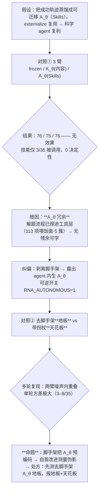
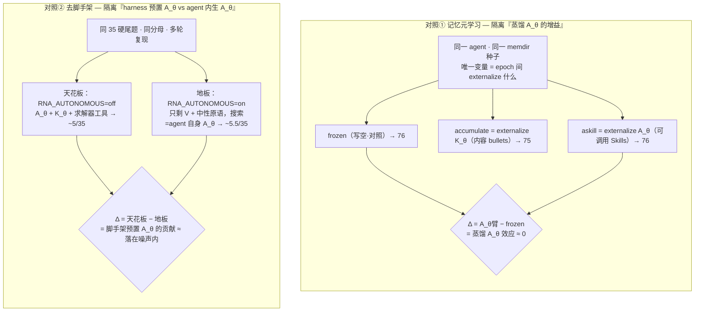

# Meta-Learning AI4S Harness：从经验中蒸馏 A_θ — 周报（2026-07-10）

> **北极星（meta-learning AI4S harness）：** 构建一个面向**科学发现**的元学习 harness——跨任务/跨 epoch，把每次成功求解蒸馏成**可迁移的算法与求解策略**，经**精确验证器 V** 门控地累积，使 agent 的解题能力**复利**；尤其针对 K_θ（记忆知识）失效的**低流形支撑/ schema 级新颖**区域。
> **追求的智能实体 = A_θ（Karpathy Cognitive Core 的算法核）：** *"从知识中剥离出来、只保留算法与问题求解策略"* 的实体（见本项目 TECH_REPORT §1.3，Table 1.2）。
> **RNA 二级结构逆设计（ViennaRNA 精确折叠 oracle）只是本命题的证明载体（proof-of-concept）**，不是目的：科学域里罕见地具备**免费、精确、可自检**的 V（$R_{\det}\approx1$、无 oracle 残差），使"A_θ 到底有没有被学到"的测量**不能赖在 oracle 噪声或反馈失真上**——任何 null 都指向机制本身。
> **红线（贯穿）：** solved = 折叠 oracle 下设计正确，不做体内/生物功能声明；记忆只能是蒸馏过程/策略（A_θ），绝不背答案（K_θ 答案序列）；不搜 Eterna100 答案。

---

## TL;DR（一句话）

用 Cognitive Core 的话说，本周想验证：**能否把 A_θ 从成功轨迹里蒸馏出来、externalize 成可复用技能，让科学 agent 复利**。结果**没能证明**——但查到底：**A_θ 已被 harness 焊进工具层，externalize 的技能只是复述、无新可学 → 测出来 NULL**。收敛出的命题是"**脚手架把 A_θ 预先编码 → 自我改进的测量变成伪影**"。要真测 A_θ，必须先**剥离脚手架**（RNA_AUTONOMOUS）露出 agent 自身的 A_θ 地板。本周末多轮复现暴露：原招牌数字（地板 3/35 vs 带拐杖 11/35）同口径下**落进噪声**，坐实"单点估计会骗人、必须多种子多模型"。

---

## 1. 理论框架：Cognitive Core、A_θ 蒸馏、与 AI4S 为何必须靠 A_θ

**模型一次行动**（TECH_REPORT eq 1.1）：

$$a_t \sim \pi_\theta\big(a_t \mid q,\; C_t,\; K_\theta,\; A_\theta,\; V\big)$$

| 符号 | 名称 | 含义 | 在本项目里 |
|---|---|---|---|
| $K_\theta$ | parametric knowledge | 参数中记住/压缩的世界知识 | 记忆的 RNA motif、答案片段（**红线：不externalize**） |
| $A_\theta$ | **algorithmic core** | **可迁移的推理、搜索、规划** | **本项目追求的实体**：分解、逆折叠搜索、诊断-修复策略 |
| $C_t$ | working memory | 当前上下文、KV cache、工具返回 | 目标结构、fold 结果、diagnose 反馈 |
| $V$ | verifier / feedback | 外部验证器、测试、环境反馈 | ViennaRNA MFE + bp_distance（精确、免费、可自检） |

**为什么 AI4S 恰恰是 A_θ 决定成败的地方**（TECH_REPORT Table 1.1 流形支撑谱系）：科学发现 = **schema-level novelty / 低密度 OOD** → 训练分布支撑**极弱** → $K_\theta$（模糊回忆）在此**失效或幻觉**，只有 $A_\theta$（可迁移算法）能迁移。所以"less memory（$K_\theta$），more cognitive core（$A_\theta$）"在 AI4S 不是口号，而是硬约束——这也是选 RNA-under-精确-V 作显微镜的理由：**V 干净，才能把 $A_\theta$ 的效应从噪声里分出来。**

**本周实验 = Cognitive Core 的直接操作化：**
- **对照① 记忆元学习** = externalize 什么？`accumulate` externalize $K_\theta$（内容 bullets）/ `askill` externalize $A_\theta$（可调用 Skills）/ `frozen` 对照。测 **Δ(A_θ 臂 − frozen) = 蒸馏 A_θ 的增益**。
- **对照② 去脚手架** = 把 harness 注入的 $A_\theta$ + $K_\theta$ 提示剥到只剩中性原语（$V$ + 最小 $C_t$ + 通用搜索），**逼搜索算法成为 agent 自己的 $A_\theta$**。地板 = agent 内生 $A_\theta$；天花板 = $A_\theta$ + harness 预置流程。

**下一步的理论输入（MIT 范畴论 AI4S，Wang & Buehler 2026, arXiv 2606.01444）——只借一个判据：**
它把 **retrieval / search / discovery** 不靠主观新颖性地分开：search = 固定 schema 内的保-provenance 更新（endofunctor）；**discovery = 经 V 验证的 schema 跃迁**，即"**超出 left-Kan-extension 函子式传输的残余内容**"。→ 给 meta-learning harness 一个 **gaming-proof 的"是否真学到 A_θ"判据**：累积只有产生"**超出传输、经 V 验证的残余能力**"才算 discovery，否则只是 search 的复述。**这精确解释了我们的 null（技能=函子式传输，残余=0）。** 诚实边界：只借判据，不套整套 copresheaf/Kan 机器（过度抽象）；该论文无 meta-learning → 与我们互补不撞。

---

## 2. 研究主线（假设→证伪→纠偏链）



---

## 3. 对照实验设计（controlled experiments，映射到 Cognitive Core）



> 设计要点：两组都**只留单一变量**（对照①只变 externalize 内容、对照②只变 RNA_AUTONOMOUS），其余 agent/种子/题集/分母全部拉齐，使 Δ 可归因。对照②的多轮复现是本周新增的严谨度硬化（§5.3）。

---

## 4. 实验计划 vs 进展

| # | 计划 | 状态 | 关键产出 |
|---|---|---|---|
| E1 | 打通 live 记忆召回，证明 memdir 真注入 $C_t$ | ✅ 完成 (07-04) | sha256 匹配；但 hairpin 家族太易 → NULL |
| E2 | 记忆**表征**：K_θ 内容 均匀 vs 多样（powered） | ✅ 完成 (07-05→06) | 均匀=中性非有害；多样 +0.09 solve 但 n=30 不显著 |
| E3 | **K_θ→A_θ 重构**：记忆改为可调用**过程**（Skills） | ✅ 完成 (07-07) | `skill_distiller.py`（红线遮蔽序列/结构）|
| E4 | 对照① 3 臂：frozen / K_θ / A_θ，4 epoch | ✅ 完成 (07-08) | **76/75/76 NULL**；根因=A_θ 冗余 |
| E5 | 对照② 去脚手架：RNA_AUTONOMOUS 门控 ~22 处 | ✅ 完成 (07-08) | flag-off 字节级不变；flag-on 只剩 V+中性原语 |
| E6 | 归因：76 分谁解的？ | ✅ 完成 (07-08) | **56/65 靠自动求解器**（LLM 编排经典搜索=search 非 discovery）|
| E7 | 去脚手架 A_θ 地板 **多轮复现**（严谨度硬化） | 🔄 进行中 (07-09→) | r1/r2 完成，r3 在跑（§5.3）|
| E8 | 下一步理论输入：MIT 范畴论 discovery 判据 | ✅ 校准 (07-10) | 借 retrieval/search/discovery 判据；余下过度抽象不套 |
| E9 | M3 工具获取 / M4 算法自优化（A_θ 进化） | ⏳ 计划中 | 需受控放开网络（红线 guard）/ 有能力 subject |

---

## 5. 阶段性结果

### 5.1 对照① 蒸馏 A_θ：**NULL**（E4）

| 臂 | externalize 什么 | 最终解出（/100，基线 65 起） | 技能调用 |
|---|---|---|---|
| frozen | 无（对照） | **76** | — |
| accumulate | $K_\theta$ 内容 bullets | **75** | — |
| askill | $A_\theta$ 可调用 Skills | **76** | **3/35，0 决定性** |

> n=1/臂、4 epoch、单模型 glm-5.2。三臂落在彼此 ±1 内。**根因不是"表征错"，而是 A_θ 冗余**：`agent_runner` 的 prompt + MCP 工具输出/docstring 已内联整套 "DECOMPOSE→DESIGN→STITCH→REPAIR" 剧本（= harness 预置的 A_θ），蒸馏的技能只是复述 → 用 MIT 判据说：**函子式传输、残余=0，是 search 不是 discovery**。

### 5.2 归因：76 = **LLM 编排经典搜索（search，非 discovery）**（E6）

```
65 条基线解 按获胜序列来源归因：
  ████████████████████████████████████████████████  56/65  自动求解器
       └ 37 MCP parallel_search/inverse_fold · 16 agent 自写 Bash RNA.inverse_fold · 3 自写 SA
  ███████                                             9/65   纯手工设计
```
> AI-for-Science agent 的一般图景：**判断/编排内化进 LLM（A_θ 的一部分），搜索计算留在外部经典求解器（V 域内的 search）**。RNA 域这份外部计算**可摊销**（便宜、精确），所以域仍允许复利——但目前的自我改进停在 search 层，未触及 discovery（schema 跃迁）。

### 5.3 对照② 去脚手架 A_θ 地板 vs 天花板 —— **诚实信号**（E7，进行中）

**原单点估计（07-08）：** 地板（自主）3/35 vs 带拐杖 11/35 → 曾据此说"~73% 硬尾能力来自脚手架预置的 A_θ"。

**多轮 head-to-head 复现（同题 35 硬尾 · 同分母 raw solve-rate · glm-5.2）：**

```
天花板(带拐杖·A_θ+K_θ):        r1 ██████ 6/35   r2 ████ 4/35              均值 ~5.0/35
地板(自主·仅 V+中性原语):       r1 ████████ 8/35  r2 ███ 3/35              均值 ~5.5/35
                                r3 进行中 …
                                └── 两臂在噪声内重叠；单轮方差 3–8/35 ──┘
```

> ⚠️ **招牌数字未干净重现。** 地板 r1（8）反而 > 天花板 r1（6）。口径拉齐后脚手架预置 A_θ 的增益没显著显现。
> **含义**：① "73% 靠脚手架"**暂不能作定论**；② 更深命题**没塌、反被支持**——硬尾上"带拐杖 vs 去脚手架**不可区分**"正说明脚手架预置的 A_θ 没买到可测能力（A_θ 冗余）；③ 框架应改为**"两臂噪声内不可区分 + 单模型方差极大 → 单点估计具误导性"**。

### 5.4 对照① 记忆表征（powered，E2）

n=30 任务 × K=3：no_memory 0.567 / seeded_uniform 0.578（Δ+0.011 n.s.）/ seeded_diverse 0.656（Δ+0.089 n.s.）；evals-to-solve：diverse 3.22 < none 3.82。
> $K_\theta$ 均匀记忆**中性非有害**（agent 的诊断-修复 A_θ 环吸收了 oracle 级 0/12 均匀误折叠）；多样记忆**方向性正效应但不可证**（要 ~120 任务才够功效）。信号在**效率**（evals），不在最终 solve。

---

## 6. 离 Eterna100-V2 SOTA 的解题能力差距

（deep-research 核实的锚点；V2 = uMFE 更严口径。"90/99"两处误传已纠正：99=V1 Montparnasse，90=削弱预算的 NEMO 基线。）

| 方法 | Eterna100-V2 | 预算 / 条件 | 类别 |
|---|---|---|---|
| **DesiRNA** (Wirecki 2025, 开源) | **97 / 100** | **~24h / 题**，REMC，Turner2004 | 经典专用求解器 **SOTA** |
| NEMO（原生 V2） | ~94 / 100 | 蒙特卡洛 | 经典求解器 |
| LLM 法 SOTA（Gautam 2026） | ~79–81 / 100 | — | LLM 方法 |
| **本项目 glm-5.2（带拐杖）** | **76 / 100** | **分钟级预算** | LLM 编排经典搜索 |
| 本项目 base（无记忆·GLM） | ~56 / 100 | 分钟级 | LLM |
| 本项目 去脚手架 A_θ 地板（35 硬尾） | ~5 / 35 | 分钟级 | agent 内生 A_θ |

```
DesiRNA   (24h/题)   ████████████████████████████████████████████████  97   ← 经典 SOTA
NEMO 原生            ██████████████████████████████████████████████    94
LLM 法 SOTA          ████████████████████████████████████████          ~80
本项目 带拐杖         ██████████████████████████████████████            76   ← 我们（分钟级）
本项目 base 无记忆    ████████████████████████████                      56
                     └──── 到 DesiRNA 差 21 分，到 LLM 法 SOTA 差 ~4 分 ────┘
```

**差距怎么读（关键，回到北极星）：**
- **到经典 SOTA 的 21 分（76→97）是"算力/预算差"，不是"A_θ 方法论差"**：DesiRNA 花 **~24h/题**（≈我们分钟级预算 10³–10⁴×）。剩余 24 题 headroom 已实测是 **solver-hard**（一条 258nt 靠 24 分钟暴力爬山才到 bp=0；一条 108nt 短硬题跑 13.5 分钟仍 fail）。
- **到 LLM 法 SOTA 只差 ~4 分**（76 vs ~80），同样 search/budget-bound。
- **含义**：继续用算力把 76 抬向 97 = **本末倒置**（报告的是求解器+硬件，不是 A_θ 学习）。on-mission 的问法：**在同一预算下，哪个自我改进机制（蒸馏 A_θ / 工具获取 / 算法自优化）能把这个数移动多少**——每个机制产生的、超出函子式传输的 Δ，才是 A_θ 学到了的证据。这把"解题率"北极星与诚实路线**和解**。

---

## 7. 现阶段收获

- **一条完整、诚实的证伪链**（Cognitive Core 语言）：蒸馏 A_θ NULL → A_θ 冗余根因 → 剥离脚手架 → 76=search 归因 → headroom 是 solver-hard。每步有代码/数据。
- **一个可逆的 A_θ 测量工具**：`RNA_AUTONOMOUS` 门控（flag-off 字节级不变），把"agent 内生 A_θ"与"harness 预置 A_θ"分开——面向一般 AI4S agent 的方法学贡献。
- **一个 gaming-proof 判据的引入**（MIT 范畴论）：discovery = 超出函子式传输的验证残余 → 给 meta-learning harness 一个客观的"是否真学到 A_θ"接受门。
- **SOTA 溯源纠偏**：Eterna100-V2 的"90/99"两处误传查清（§6）。

## 8. 瓶颈与风险

- **实证严谨度（头号风险）**：核心数字 n=1/臂、单模型 glm-5.2；招牌"73%"多轮下落进噪声。**glm 的 run-to-run 方差足以吞掉整个效应** → 必须多种子 × ≥2 模型。
- **单域证据**：只 RNA；"精确 V 正对照域"框架能顶一部分，但泛化到其他 AI4S 域（蛋白/材料，如 MIT 论文的域）仍是待验证的预测。
- **A_θ 进化（M4）压舱实验空**：glm-5.2 驱动失败（推理吃光 token），需有能力 subject（预算/接入）+ 有 null 风险。
- **工具获取（M3）红线**：受控放开网络时**只准装 solver，禁 fetch 答案序列**，guard 需写死。

## 9. 下一步（优先级）

1. **让去脚手架 A_θ 地板复现跑满 n≥3/臂**（r3、必要时 r4）→ 配对差 + bootstrap CI，判定地板-天花板差值是否真压在 0。
2. **并行加开第二个模型**（deepseek / sonnet）同协议 floor/ceiling —— 攒多模型证据，压住方差。
3. **给 meta-learning harness 装上 discovery 判据**（MIT）：累积的 A_θ 只有产生"超出函子式传输、经 V 验证的残余能力"才计入 → 把 §5.1 的 null 从"表征问题"升级为"是否发生 discovery"的客观测量。
4. **（可选）M3 工具获取 mode**：agent 撞墙后自主找/装开源 solver（红线 guard 写死），两种结果都干净（真 climb / 揭示墙是算力）。
5. **M4 A_θ 自优化**（FunSearch 式，待有能力 subject）：让 agent 用 V 进化自己的设计算法——这是"蒸馏 A_θ null"之外唯一可能的正结果，也是最贴近"从经验中长出 A_θ"的机制。
6. 长尾**只做 designability split 归因**（agent-limited vs oracle-limited），不碰算力。

---

*数据来源：`rna_harness/runs/`（meta_ladder_* / p1 tmux 日志）；Cognitive Core 见 `docs/TECH_REPORT.md`；SOTA 锚点见 `docs/eterna100_sota.md`；MIT 判据 arXiv 2606.01444。所有 [verify] 计数在下结论前须再对齐 runs 产物。*
