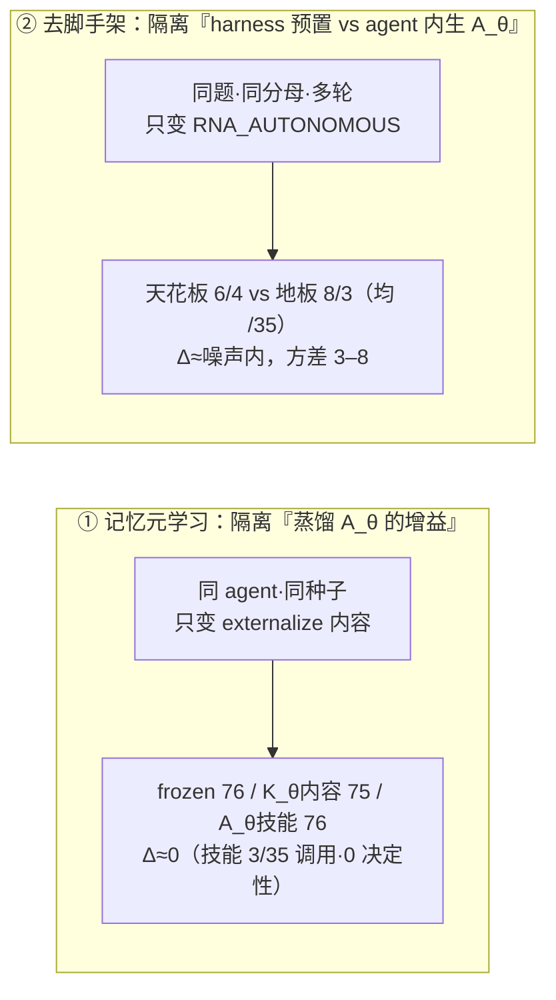

# Meta-Learning AI4S Harness — 周报（2026-07-10）

> **北极星：** 构建面向科学发现的元学习 harness——跨 epoch 蒸馏、经精确验证器 $V$ 门控地累积**可迁移 $A_\theta$**（Karpathy Cognitive Core 的算法核 =「剥离知识、只留算法与求解策略」），使 agent 解题**复利**。RNA 逆设计（ViennaRNA 精确 oracle）是 **proof-of-concept**：$V$ 干净，任何 null 只能归因机制、不能赖噪声。**红线：** 只蒸馏策略，绝不背答案。

## 结论（TL;DR）

本周验证「蒸馏 $A_\theta$ → 复利」：**NULL**。根因 = **$A_\theta$ 已被 harness 焊进工具层（冗余）**，externalize 的技能只是复述、无残余可学（借 MIT 范畴论判据：这是 *search* 的函子式传输，非 *discovery*）。要真测 $A_\theta$，须先**剥脚手架**（`RNA_AUTONOMOUS`）露出 agent 内生 $A_\theta$。**多轮复现暴露**：招牌数字（地板 vs 天花板）同口径下**落进噪声** → 单点估计误导，必须多种子 × 多模型。

## 1. 两组对照实验（映射 Cognitive Core）

**归因（76 分谁解的）：** 65 条基线解中 **56 靠自动求解器**（37 MCP + 16 agent 自写 Bash + 3 自写 SA），仅 9 纯手工 → **76 = LLM 编排经典搜索 = *search*，非 *discovery***。

> ⚠️ 招牌「~73% 靠脚手架」多轮复现**未重现**（地板 r1=8 反而 > 天花板 r1=6）；结论应改为「两臂不可区分 + 单模型方差极大 → 单点估计误导」。这反而**支持**更深命题（$A_\theta$ 冗余）。r3 进行中，n≥3/臂后出配对 CI。

## 2. 离 Eterna100-V2 SOTA 的差距

| 方法 | V2 | 预算 | 类别 |
|---|---|---|---|
| DesiRNA（开源 SOTA） | **97** | ~24h/题 | 经典求解器 |
| LLM 法 SOTA | ~80 | — | LLM |
| **本项目 带拐杖** | **76** | 分钟级 | LLM 编排搜索 |
| base 无记忆 | 56 | 分钟级 | LLM |
| 去脚手架 $A_\theta$ 地板 | ~5/35 | 分钟级 | agent 内生 $A_\theta$ |

**读法：** 到经典 SOTA 的 21 分是**算力差**（DesiRNA 花 10³–10⁴× 预算；剩余 24 题实测 solver-hard），非 $A_\theta$ 方法论差；到 LLM 法 SOTA 仅差 ~4 分。→ 堆算力抬数 = **本末倒置**；on-mission = 测**哪个自改进机制能在同预算下移动这个数**（其超出函子传输的 Δ 才是 $A_\theta$ 学到的证据）。

## 3. 收获 · 瓶颈 · 下一步

**收获：** ① 完整诚实证伪链（蒸馏 $A_\theta$ null → 冗余 → 剥脚手架 → 76=search）；② 可逆 $A_\theta$ 测量工具 `RNA_AUTONOMOUS`（分开内生 vs 预置 $A_\theta$，flag-off 字节级不变）；③ 引入 MIT discovery 判据（discovery = 超出函子传输、经 $V$ 验证的残余）作 harness 客观接受门。

**瓶颈：** ① **严谨度（头号）**——n=1/臂、单模型 glm-5.2，方差吞掉效应；② 单域（RNA），泛化待验证；③ M4（$A_\theta$ 自优化）需有能力 subject；④ M3 工具获取红线（只装 solver、禁 fetch 答案）。

**下一步：** ① 去脚手架复现跑满 n≥3/臂 → 配对差 + bootstrap CI；② 并行加开第二模型（deepseek/sonnet）压方差；③ 给 harness 装 discovery 判据；④（可选）M3 工具获取 / M4 $A_\theta$ 自优化作正结果候选。

---
*数据 `rna_harness/runs/`；Cognitive Core `docs/TECH_REPORT.md`；SOTA `docs/eterna100_sota.md`；MIT 判据 arXiv 2606.01444。所有计数投稿前须对齐 runs 产物。*
