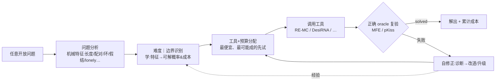

# RNA 逆向设计 → 通用认知核：从"解题"到"经济地编排工具" — 周报（2026-07-14）

> 本周一条完整弧线：**提升硬题解题效率 → 精确定位边界 → 度量与视角的转变（cost）→ 认知核**。
> 原则：只报做过/量过的；对被数据推翻的自我判断如实纠正；不夸大低门槛结果；不谈论文。
> 北极星不变：**meta-learning AI4S harness**，RNA 逆向设计（ViennaRNA MFE oracle，`solved = MFE 折叠 == 目标`）为干净试验台。

## TL;DR

- **视角上移**：DesiRNA 已把 Eterna100-V2 解到 **97/100** 且泛化好——"解题"基本商品化，**前沿上移到"经济地编排工具"的元过程**。价值单位不再是求解器，而是**认知核**。
- **度量换轴**：solve-rate → **cost-to-solve（$）**。求解器成本 = CPU-秒，LLM = token；**跑到解出、记录成本，绝不"设时限就叫墙"**。
- **记忆（AF1 式检索 warm-start）→ NULL**：固定预算下 memory ≈ 通用先验；收益不来自积累的经验。
- **搜索重构 → 有界化成功、非银弹**：从零 bpp 引导失败；补丁式局部搜索大 n 失控；换 **replica-exchange MC（并行回火）** 后干净有界，但残差没啃下。
- **纠正"墙"**：bp=1 残差多是**预算假象**——DesiRNA 给 10–30 分钟就解出 89/92/64/79；对齐 97/100，**真墙 ≈ 3**，残差绝大多数是"搜索弱 / 算力不够"，非不可设计。
- **DesiRNA 编排（Plan-A：调成熟工具）**：58（模型）→ **81–83**（快档）→ 大预算收官 **86**；纯**工程链路**胜利，非学习。
- **跨出 MFE 盒第一步（假结/RNAInvBench）**：MFE oracle 对假结**假阳 29%**；纠正"DesiRNA 出模型"的误判——**咬人的边界是 verifier 不是 solver**。
- **认知核已落地**：`rna_harness/cognitive/`（cost/features/tools/router/core/evaluate），**领域无关**（RNA 全在工具里）、**纯 ML 工程可搭、无需生物知识**、24/24 测试、经审查。
- **诚实门槛**：当前只清了低门槛（"便宜先试" < "每题烧 SOTA"，易题便宜 ~10⁵ 倍）；**真正门槛（学习是否降本）在下一步**。

---

## 1. 视角转变（本周最重要的一步）

**旧问法**：我们的搜索能追上 SOTA 吗？→ 追不上、也不该追（DesiRNA 97/100、泛化好）。
**新问法**：既然具体求解器已商品化，**稀缺的是给定任意问题、判断它是什么/多难/边界在哪、调哪个工具、给多少预算、卡住怎么改、以最低成本解出**——这套**人类专家式元过程**才是通用、可跨领域迁移的能力。

度量随之换轴（生物专家意见 + 本周教训逼出）：

| | 旧 | 新 |
|---|---|---|
| 单位 | 解出 / 未解 | **cost-to-solve（$）** |
| 求解器 | 墙钟 cap | **CPU-秒 = 核数 × 墙钟 → $** |
| LLM | — | **总 token → $** |
| 判死 | 设小时限 → "墙" | **跑到解出、记成本；不 cap-and-mislabel** |
| 价值判据 | 解得多不多 | **同等质量下总成本更低吗？（且能否泛化）** |

---

## 2. 搜索线与边界（先记忆、后搜索，走到头并精确定位）

### 2.1 检索记忆（AF1 式 warm-start）→ NULL
`retrieval.py`（单元 exact-hash 库）+ `frozen_budget.py`（4 seed、同一冻结 refine 预算）+ 10/10 单测（oracle 门控、防泄漏、绝不读 sample）。冻结预算 34 题、**公平公共子集 n=28**：priors/memory/memory_clamp 三臂**均值 bp 无法区分**（b50: 12.2/12.3/12.8；b1000: 3.7/4.5/4.4）。之前"clamp 完胜"是**截断偏差**。配对头对头 memory 净负；覆盖率→收益 **负**。→ **检索记忆不优于通用 GC-刚性先验**（局部化收益 ≈ 组合保真度惩罚）。

### 2.2 搜索重构：三步
1. **从零 bpp 引导（`guided_search.py`）→ 失败**：单轨迹贪心无重启，全线不如现有多重启定向爬山；AF1 的"平滑势引导"用 bpp 没赢过 MFE-缺陷引导。
2. **`bounded_solve.py`（迭代爬山+close_pair）→ 强但暴露"补丁"问题**：大 n 上多组件各自失控（`inverse_fold` 无界曾挂 45 分钟；`close_pair` 4000 步在 400nt ~200s）= 打地鼠。
3. **`anneal.py`（replica-exchange MC）→ 有界化成功**：统一 fold-call+墙钟预算，Metropolis + 多温度副本 + 相邻交换 + 90% 定向打错配位。**再无挂死**；易题秒解（pid36：135 折叠）；**但残差没啃下**（pid57 砸 40 万折叠仍 bp=1）。

### 2.3 残差扫描 + 分类（`anneal.py`，42 题）
解出 13/42；bp 分布 median≈1.5。**尺寸不是墙**（337nt 的 pid51 仅 486 折叠解出）；决定难度的是**结构**。残差两类：A「最后一毫米」（中等题、折叠管够仍差 1–3 对）、B「大题折叠饿死」。**纠正自我断言**：我一度说"残差=lonely/triloop 可设计极限"，数据推翻——A 类含 lonely=0 的干净结构（pid50/64/83）也卡。

### 2.4 可设计性诊断（仅用 sample 判定、绝不喂求解器）
**29 个残差里 28 个可证明可设计（sample 能折到目标），仅 pid 100 不可设计**。→ **丢分是搜索+算力问题，不是可设计性的墙。**

---

## 3. 纠正"墙"：用成本度量实测（本周关键纠偏）

昨天把"折叠管够仍差 bp=1"当硬墙。**成本度量实测推翻**：给 DesiRNA **10 分钟**，6 道"疑似墙"里 **89/92/64 解出**；给 **30 分钟**，**79 也解出**，只剩 **71/87** 仍 bp=1。对齐 DesiRNA 分档（**85@1 分钟 / 97@24 小时**）：我只给了 1–3 分钟（≈85 快档），**真墙（连 24 小时都不解）≈ 3**。**教训**：`bp=1 未解 @ 小预算 ≠ 墙`；只有"跑到解出记成本"才能区分"贵"与"不可解"。

---

## 4. AF1 横向映射的结论（联网核对）

AF1 靠**共变（外部信息源）+ 学到的平滑势（让搜索可解）**跃升。映射到我们：
- **共变支柱不迁移**：预测里共变是提取来约束**未知结构**的信息；我们是**设计**，结构已知，碱基配对的"共变"是**已施加的约束**（搜索本就保持互补）——不提供新信息。
- **前向已又准又便宜**（ViennaRNA O(n³)），不需学到的势让折叠可解。
- **唯一可借**：学到的 (结构→序列) 先验当搜索 **warm-start**，只对"可设计但算力贵"的题、数据须自产、收益未知 → **不急上 GPU/RL**。

---

## 5. 宏观重构：认知核 = 稀缺的通用能力

DesiRNA / RE-MC / MFE-oracle / pKiss / decompose 都退为**工具**；harness 的认知核 = **元过程本身**。

1. **领域无关**：领域知识**已封装在工具里**（ViennaRNA/DesiRNA/pKiss）。认知核只学"什么特征→调哪个工具/多少预算最划算"——**纯成本敏感 ML，零生物知识**。**正因为不用域知识、纯从"跑工具的结果"学，它是通用核，不是 RNA hack。**
2. **学习合法重进场**：背 Eterna 答案 = null（已证）；但学**路由/分析策略（A_θ = 可迁移过程）**应随经验降成本——这才是学习该在的地方，用成本可测。
3. **可证伪 + 防自欺**：若退化成"永远无脑调 SOTA 满预算"就是**壳**。它配称认知核，**当且仅当同等解题质量下总成本显著低于固定策略**（永远-SOTA / 永远-便宜 / 随机），且**泛化到没调过的开放问题**。

---

## 6. 已建成：领域无关认知核流水线（本周主要技术产出）

`rna_harness/cognitive/`，全程零生物、RNA 只在工具层：

| 模块 | 作用 | 领域无关? |
|---|---|---|
| `cost.py` | 统一经济单位 $：求解器=CPU-秒、LLM=token | ✅ |
| `features.py` | **机械**结构特征（长度/配对/环/假结/lonely/嵌套…），对假结鲁棒 | ✅ |
| `tools.py` | 统一 `Tool` 接口：RE-MC + DesiRNA 包成动作，**用正确 oracle 复验**（MFE/pKiss），每次带成本 | RNA 在此 |
| `router.py` | 冷启动（最便宜先试）+ **k-NN 学**（按 成本/解出概率 排序）；学到的路由 = 可迁移过程 A_θ，可持久化 | ✅ |
| `core.py` | 认知循环：分析→路由→调用→复验→自升级，全程记成本 + 喂 router 学；含 `FixedPolicy` 基线 | ✅ |
| `evaluate.py` | cost-at-quality：cognitive vs always_cheap vs always_sota | 加载数据 |

- **测试** `tests/test_cognitive.py` **9/9**；全套 **24/24**（+retrieval 10、desirna 5）。
- **审查已过**：逻辑逐条对齐讨论；查修 2 处问题（`features` 静默退化、`evaluate` 冗余）；5 处一致性风险（oracle 一致性、DesiRNA 字段、特征顺序、防除零、record/plan）核清；grep 验证核心 `cost/features/router/core` **零 RNA 导入**。
- **可证伪主张**：*同等解出数下，认知核总成本($)低于任何固定策略，且优势泛化到没调过的开放问题。*

---

## 7. 现状数字（诚实的成本阶梯）

| 谁 / 预算 | Eterna100-V2 解出 | 性质 |
|---|---|---|
| 基座模型（GLM-5.2，无工具） | 58/100 | 起点 |
| + DesiRNA 编排（1–3 分钟/题，快档） | **81–83/100** | **工程链路**胜利，非学习（绿区 null 的部署侧陈述）|
| + 大预算收官（A 类 5/8） | **86/100** | 10 分钟/题；71/79/87 死磕 bp=1 = frustration 硬底 |
| DesiRNA（24 小时/题，已发表） | 97/100 | 靠时间换 |
| **真墙（谁都解不出）** | **~3/100** | 候选 71/87（30 分钟仍 bp=1）+ pid100（sample 都不折叠，疑参数）|

**cogeval 预览**（cost-at-quality，进行中）：易题上 `cognitive`（remc@5 秒解，$≈3e-7）比 `always_sota`（DesiRNA 满 180s×10 核，$≈2.6e-2）**便宜 ~10⁵ 倍**。⚠ **这是低门槛**，尚不证明认知核成立——真门槛在 §10.1。

---

## 8. 跨出 MFE 盒第一步：假结（RNAInvBench）+ verifier 是真正的边界

- **数据/工具**：RNAInvBench（COLA-Lab，MIT）`/data/wenhui/RNAInvBench`，假结集 **Pseudobase++ 251 题**；假结 verifier **pKiss**（隔离 env `pk`）已接通。产物 `benchmarks/rnainvbench.py`（`verify_pk` 等）。
- **关键测量 bug（harness 自身）**：ViennaRNA MFE 是**无假结模型**，静默丢 `[]{}`。对照 24 题：MFE oracle 报 24/24，**pKiss 真值 17/24 → 假阳性 29%**。
- **纠正自我判断**：我最初判"DesiRNA 在假结上出盒子（只建骨架）"是**错的**——逐案 PK 位点互补 4/4、6/6、5/5，DesiRNA 真能设计假结（pKiss 确认）。**真正缺陷在我们的 MFE oracle，不在 DesiRNA。非-MFE 问题上咬人的边界是 verifier，不是 solver**——认知核要为每类问题**选对 oracle**（29% 假阳是"oracle 才是关键"的量化实证）。
- **修复已落地**：`has_pseudoknot` 统一 guard 接入 `verifier.py` + `generators/desirna.py`（假结目标拒绝 MFE 假 solved）；`test_pseudoknot_guard.py` 4/4，全套无回归。

---

## 9. RNA 生物专家意见梳理（含分析）

- **指标（bp 距离为主、solve-rate 为次）**：本周数据完全证实，且是看清边界的关键（solve-rate 一片平；bp 分布立刻暴露"27 个失败里 15 个差≤3 对"）。已实例化为 `experiments/solvedness.py`（`bp` 主 + `ensemble_defect` 平滑信号 + `min_pair_prob` 诊断最后一毫米）。三点修正：单题内**硬卡**非平滑趋近；**报分布非只中位数**；**bp=1 ≠ 生物接近度**。
- **冻结搜索预算（隔离经验 vs 更强搜索）**：本 session 原样实现并跑出 **NULL**（memory ≈ 无记忆先验）。一点修正：专家设的"经验 vs 更强搜索"二选一，真实瓶颈**两者都不是**——是"最后一毫米局部最优墙"（无记忆、干净结构也卡）。
- **更广清单（open items，需协作者）**：跨-oracle 校准、湿实验约束、胞内/修饰碱基、动力学陷阱、进化过滤、3D 合理性、真实耦合目标、sandbox→湿实验桥。→ 多指向 **oracle 丰富化**；在盒内问题穷尽前先不逃逸。

---

## 10. 两轨路线图 + 下一步

被测对象 = 认知核；RNA 是测试台；数据集构成 2×2：

| | **闭域·便宜 oracle（MFE）** | **开域·出模型（假结，需 pKiss）** |
|---|---|---|
| 数据集 | Eterna100（42 硬） | RNAInvBench / Pseudobase++（251） |
| portfolio | 都能 → 比**成本** | MFE 工具出模型 → 比**能力** + 贵 oracle 成本 |
| 核心问题 | 会不会便宜地分配、并学着更便宜 | 会不会识别"该换 oracle"、在贵 oracle 下仍经济 |

**下一步（优先级）**：
1. **真门槛（非低门槛）**：多趟评测 **learning vs no-learning**——学到的 router 能否胜过冷级联（尤其砍掉硬题上注定失败的便宜尝试）。**这才是"认知核 vs 壳"的判据**，用成本可证伪。
2. **开域轨**：先功能冒烟 `verify_pk`，再让**同一认知核**在假结上测（识别出模型/换 oracle，贵 oracle 下仍经济）。
3. **B 类大题**：给更多有界算力评估（与"学习"分开）。
4. **真墙确认**：71/87 给 24 小时档彻底钉死是否 ∈ 那 ~3 道。

---

## 11. 诚实的风险 / 未决

- **当前 cogeval 是低门槛**；不拿"便宜 ~10⁵ 倍"当"认知核成立"（§10.1 才是真判据）。
- **DesiRNA 成本按 10 核算，低估其真实多线程 CPU**（实测每副本 400–700%）——三策略一致低估，对认知核**保守**。
- **单趟 → router 只轻度学习**；DesiRNA 非确定 → 非逐位可复现；后续多种子/多趟。
- **180s cap = 经济预算**：>180s 的最硬题（71/87）暂排除出成本对比集（会让所有策略平等失败、无区分信号）。
- **Track B 的 pKiss verify 路径已编码但未功能冒烟**——开域跑前必做。
- 样本量小（检索 n=28–34、单模型建库、单种子）；"记忆 null / 共变不迁移"是**存在性级**判断，非充分 powered 的定量主张。

---

## 12. 一句话

> **本周把问题从"造更强的 RNA 求解器"（已被 DesiRNA 商品化）转成"造一个领域无关、纯 ML 工程、把 RNA 知识全留在工具里的认知核——它经济地分析、识边界、路由、自修正，并学着更便宜地做这件事"。** 认知核已建成、测过、审过；下一步用成本度量在多趟 + 开域上检验它是真核还是壳——这一步任何 ML 工程者都能做，不需要我们任何一方懂 RNA。
