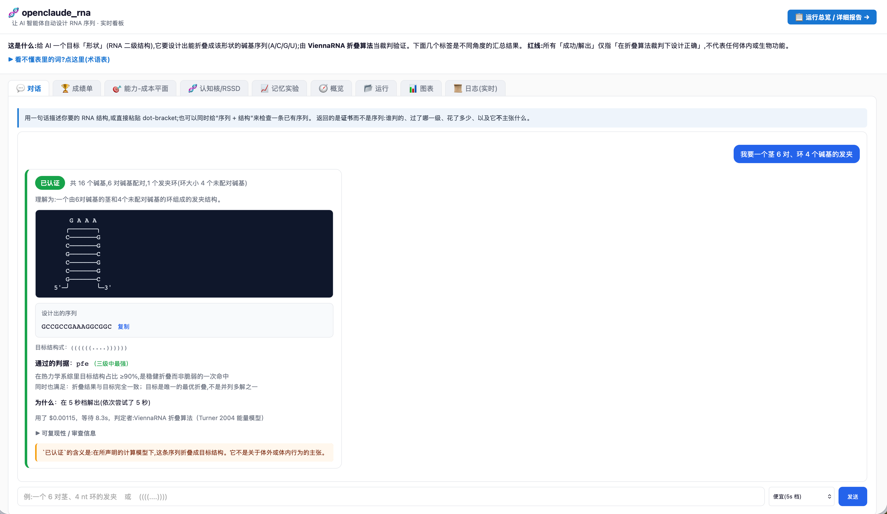

# 周报（2026-07-30）：RNA agent 的当前能力与边界

> 对象:分支 `rna-ceiling`。目标:**让不精通 RNA 的人便捷、便宜、正确地拿到 RNA 技术验证** —— 与 Claude Code 同形。
> 本报告只写**当前成立的结论**。此前若干中间数字已被后续实验推翻,不再列出;完整过程在 git history(`git log --follow docs/weekly-report/`)与 `rna_harness/runs/ceiling/` 的逐条 json 中。
> 红线:`solved` 仅指在折叠 oracle 下正确,**不含任何体内(in-vivo)主张**。

## TL;DR

| 目标 | 完成度 | 一句话 |
|---|---|---|
| ① 通用易用 | **≈80%** | 三种提问形式 vs 它一种;但复杂形状仍需会写点括号 |
| ② 更快更便宜 | **≈55%** | 便宜 2.66× 来自**调度器**;13× 的溢价里 **93% 是成本上限越界**,已修(上限现在截断档位梯子);循环本身仍贵 2.86× |
| ③ 范围 + 开放推理 | **≈75%** | 10 类要求已测;缺口**三条**(组分 / 共转录 / 两态开关),且**五个坐标全部测完、地图闭合**;"未知开放"仍为 0 |
| ④ 极限问题(**判据缺失**的地方) | **≈60%** | 判据经**留出集 + 硬零假设**复核(78.5% [68.8,86.3];嵌套诱饵误收 0/183);1/55 → 51/55;端到端 62/64;**M2 分配 null**;残差 5/8 是钱买得到的;两条新缺口已**上线为原语**,用户要得到;搜索能力仍为 0 |
| ⑤ 审查报告 | **≈85%** | 五条里最强 |

> **最诚实的一句话**:这个项目能证明的是 **"它不会给你一个错答案;在一类明确的要求上它能交付而工具不能;在一个连验证器都不存在的领域里,它给出了一把标定过的、错误率已公布的尺子"**。它**不能**证明 **"它搜得更多或更难"** —— 同预算下两臂不可区分,序列全部由 DesiRNA 产生。
>
> 那一类"工具交付不了的要求",经控制变量检验后是**三条**:组分方向一条(组分、低熔点、正交性是"要求更少 GC"的三种说法)、**折叠路径**一条(共转录)、**伙伴在场**一条(两态开关,同 GC 下 35/58 → 54/58)。而且**这三条来自一张已经闭合的地图**:求解器的目标函数只描述一个"点",把这个点解开的五个方向已全部测完(§3.6d)。
>
> 而假结那条(§4.1)之所以值得押,是因为**那个领域的真正瓶颈本来就是判定,不是搜索**:DesiRNA 搜得够好,专家真正做不到的是低成本、可复现地判断答案算不算数。我们的贡献正好落在瓶颈上。

判定口径:**已测且确认 = 成立;已测且否定 = 不成立;未测 = 不计分。** 完成度 = 已确认子命题 / 全部子命题。

> **本期做了一次口径修正,记录在案。** 上一版把 ④ 拆成 ④a(同一问题的更难实例)与 ④b(判据缺失的开放难题)并列。这是错的:"更难的实例"是**某个评测集的难度百分位**,换一个 benchmark 就重排,不是能迁移的性质;"判据缺失"是**结构性**的(交叉碱基对在 Turner 模型里无法表达,所以验证器不存在),跟数据集无关。并列会让账面读成两条前沿,实际只有一条。现在 ④ **由结构性判据定义**,Eterna100 残留降为 **④ 在一个特定数据集上的封闭负结果**(§4.3)。

---

## 1. ① 通用易用 —— 4/5



**这张图就是这一节的全部主张,一屏之内可以逐条对上:**

| 图里能看到的 | 对应的主张 |
|---|---|
| 用户只打了「我要一个茎 6 对、环 4 个碱基的发夹」 | 提问形式 = 自然语言,**不需要写点括号**(§3.1) |
| 回的是**「已认证」**而不是一条裸序列 | 交付物是**证书**,不是答案(§5) |
| 「通过的判据:`pfe`(三级中最强)」并解释它是什么 | 判据被**命名并翻译**,而不是留给用户自己判断 |
| 「$0.00115,等待 8.3 s,判定者:ViennaRNA(Turner 2004)」 | 成本、耗时、**裁判是谁**三样都在证书上(§5) |
| 底部橙框:「`已认证` 的含义是……**不是关于体外或体内行为的主张**」 | 红线**印在交付物上**,不是只写在文档里 |
| 结构简笔画 + 「理解为:一个由 6 对碱基的茎和 4 个未配对碱基的环组成的发夹结构」 | 把点括号**复述回人话**,确认没有理解错 |

**图里同样看得见的边界**:这一条之所以能用一句话说清,是因为它是发夹 —— 我们的语法只有 5 类元素。真实 bpRNA 结构几乎没有一个能这样说出来,那是本节唯一的 ❌。

| 子命题 | 度量 | 数 | |
|---|---|---|---|
| 自然语言直接提问 | 三形状家族基准 | **17/18 × 3 次独立复跑**,分项完全一致 | ✅ |
| 用户已有结构也能进 | bpRNA 真实结构采纳率 | **24/24** | ✅ |
| 覆盖多种结构 | 发夹 / 多分支 / 假结 | 6/6 · 5/6 · 6/6 | ✅ |
| 非专业输出 | 中文、结构简笔画、网页对话、CLI、MCP | 已交付 | ✅ |
| 任意形状都能用话说出来 | 语法元素数 | **5 类**;真实 bpRNA 结构几乎无一可表达 | ❌ |

**边界**:不会写点括号 + 想要复杂形状 = 门槛仍在。用户手里已有点括号时,`use_target` 由**代码**抽取请求里字面存在的结构、模型只传下标 —— 模型永远无法引入用户没写过的括号。

## 2. ② 更快更便宜 —— 2/4(成本可预测性本期显著改善)

| 子命题 | 数 | |
|---|---|---|
| 比 DesiRNA 便宜 | Eterna100 **84/100 $2.6697 → 84/100 $1.0041 = 2.66×**,解出数一字不差 | ✅ |
| 费用档次约束 | `cheap` / `standard` / `best_effort`,被遵守 | ✅ |
| agent 循环更快 | 无约束请求 **贵 2.86×、慢 2.41×**($0.0268/163s vs $0.0094/67s) | ❌ |
| 便宜来自 agent | 便宜来自**级联调度**;循环是加价项 | ❌ |

**已量的剩余空间**:完美预知上界 84/100 @ $0.2991 → 还剩 **3.36×**。四条已测的路全部到底:早停 1.156×、阶梯重塑 1.097×、多种子探测 null、学习式弃答 0/16。

**循环溢价的构成**:$0.0268 中 **$0.0094 是求解器 —— 与直接调用的 $0.0094 完全相同**,溢价全部是模型思考。八条轨迹曾完全相同(`use_target → check_feasible → design`),其中前两步没有可选项,现由代码直接完成,溢价因此从 8.75× 降到 2.86×。

**本期修掉的一个真 bug —— 它是 13× 里的 93%。** 假结端到端上 agent 的求解器总花费 $1.0187,其中:

```
pseudobase:88    10 步  $0.5111   5033 秒   not_found
pseudobase:174    7 步  $0.4354   8948 秒   not_found
                        = $0.9465,占 93%
```

根因是成本上限**查错了地方**:它在步与步之间查,而一次 `best_effort` 的最后一档是 1800 秒 × 10 副本 —— 一个已花到 $0.49 的 run 在 $0.50 上限下**仍然可以再押上半小时**。已移到**选梯子的地方**:`design()` 拿到真实剩余额度,只保留装得下的档位前缀(超额系数 2.0,由实测 5 秒档 $0.00121 对预测 $0.000694 = 1.74× 上取整而来)。**$0.50 上限下 1800 秒档现在够不着。**

刻意保留的一条:**永远至少跑一档**。上限若能变成"一次都不跑",它就成了静默的无答案 —— 正是本项目反复在抓的失败类。截断原因写进 observation,让 agent 看见"梯子被砍短",而不是自己推断"这靶标很难"。

## 3. ③ 范围更大 + 开放推理 —— 8/11

### 3.1 能接受的提问形式

| | DesiRNA | 我们 |
|---|---|---|
| 点括号 + `seq_restr` | ✅ | ✅ |
| 自然语言描述形状 | ❌ 无接口 | ✅ 17/18 |
| 用话表达的多重要求 | ❌ | ✅ |
| **计** | **1 种** | **3 种** |

### 3.2 能同时保证并验证的要求种类

**10 类要求已实测,5 类有大缺口 —— 控制变量证明其中 3 类是同一个缺口,共转录与两态开关各自独立**(见 §3.6)。原样报出全部,包括我们也做不到的:

| 要求 | DesiRNA 实测 | 我们 | 缺口 | 统计 |
|---|---|---|---|---|
| 折叠匹配 | **72/72** | 72/72 | 无 | — |
| 钉扎 `seq_restr` | 282–400 nt 上守住 **95–100%** | 同 | 无 | — |
| 严格度 `umfe` | 18/18 | 18/18 | 无 | p=1.00 |
| 严格度 `pfe` | 18/18 | 18/18 | 无 | p=1.00 |
| 硬禁止子序列 | 106/108 | 108/108 | 无 | p=0.50 |
| 靠近给定参考序列 ≥60% | 0/30 | 2/30 | 无(**双方都不行**) | p=0.50 |
| **组分(GC)** | **3/72** | **68/72** | ✅ | **p=5.4e-20** |
| **熔解温度** | **12/60** | **54/60** | ✅ | **p=4.6e-13** |
| **正交序列集合** | **0/5** | **4/5** | ✅ | 接口里写不出 |
| **共转录折叠(动力学)** | **8/24** | **19/24** | ✅ **独立于组分** | 配对控制 3/11 → 9/11 |
| **两态开关(伙伴在场)** | **35/58** | **54/58** | ✅ **同 GC 下成立** | 逐条钉死 GC,p=3.8e-06 |
| 环区可及性(系综) | 40/48 | 40/48 | 无(**免费**) | 折对之后 40/40,p=1 |

组分那一条,6 形状 × 4 请求 × 3 种子,组分开关按其 parser 文档调用(`-acgu on -acgu_content A,C,G,U`):

```
DesiRNA 自己交付的答案,折叠对 AND 组分达标      3/72
筛选它自己的候选池,两个都要                    68/72
它自己的答案折叠正确(不看组分)                72/72   ← 关键
答案本来就在它自己池子里却被丢弃                65/72
```

McNemar 精确检验,同一次运行成对:**65 胜 0 负,p = 5.4e-20**。

**求解器没有失败 —— 它每一次都完美解决了折叠问题。** 它在回答另一个问题,然后它自己的挑选把同时满足两个要求的序列扔掉了(池中通常有 20–75 条合格)。**同一求解器、同样秒数、同一池子,零额外搜索** —— 因此这是**交付能力**的主张,不是搜索能力的主张。

我们也输的地方:junction-3 在 GC 30%/40% 上 4 次全败,**200 条池子里一条合格的都没有**。筛选变不出不存在的东西。

### 3.3 病态请求的三类正确行为

| 类 | DesiRNA | 我们 |
|---|---|---|
| 可行 | 解 | **6/6** |
| 冲突但长度自由 | **无此概念,永远搜不到** | **6/6 重述问题** |
| 真正不可能 | 烧完预算,返回一条像答案的近似 | **5/6 拒绝,6/6 指出冲突位置** |

### 3.4 非我们设计的结构(bpRNA)

`wild_suite` 的结构取自 RNAInvBench 嵌套池,确定性步长抽样,筛选条件跑前声明并逐条汇报丢弃数。

| | 结果 |
|---|---|
| `pinned`(钉在未配对位) | **8/8** |
| `conflicted`(钉在真茎两侧 + 锁死长度) | **8/8** |
| 找到并指出冲突位置 | **8/8** |
| 采纳用户自己的结构 | **24/24** |
| 交付了与用户所给不同的结构 | **0/24** |

### 3.5 假结:别人给不了的设计 + 诚实的"不能确认"

| | 标准工具(单 oracle) | 我们(池 + 三方合取) |
|---|---|---|
| 经独立面板确认的证书 | **0** | **16/125** |
| 无法确认却已签发 | **96** | **0** |
| 明确拒绝 | 0 | 80 |

**措辞纪律**:那 96 张只能称"**未确认**",不能称"假" —— 同一套面板对 250 个**天然**结构也只认得 2 个,所以通不过面板几乎不含信息量。

> 上面这张表用的是**最严**规则(3/3 逐对精确复现)。"面板对天然结构也只认得 2 个"正说明这条规则不可用于交付 —— 后来标定出的出厂规则、以及它把这个领域从 1/55 变成 51/55 的过程,见 **§4.1**。

### 3.6 缺口有几条:组分方向三条塌成一条,路径方向新增一条

三个已确认的缺口,交付的序列全都比工具的答案 GC 更低(组分 50.0% 对 67.9%;正交集合 50.0% 对 73.1%;熔解温度的缺口在请求不再要求降低稳定性时塌掉)。所以"**一个缺口穿了三件衣服**"是对证据的合理读法,必须检验而不是辩掉。

**控制变量:把正交集合基准的两臂都限制在 GC 45–58%。**

| 形状 | 工具在带内的序列 | 工具集合 | 我们集合 |
|---|---|---|---|
| hairpin-10 | 0 | 0/8 | 8/8 |
| internal-loop | 0 | 0/8 | 8/8 |
| junction-2 | 1 | 1/8 | 5/8 |
| junction-3 | 0 | 0/8 | 5/8 |
| two-hairpins | 0 | 0/8 | 8/8 |

**工具在这个带里几乎一条序列都没有** —— 它的答案在 73% GC。一旦把组分固定住,它没有任何东西可以贡献,**它在正交性上的失败完全归约到组分**。(我们也从 4/5 掉到 3/5,带宽同样吃掉我们的候选。)

> **组分方向上多出的求解能力是【一条】,不是三条。**
> 求解器的目标把 GC 往上推;**组分、低熔点、正交性,是三种"要求更少 GC"的说法。**
> 这**结构性而非偶然**:GC 比例是折叠稳定性的主导杠杆,所以几乎任何"要付出稳定性"的要求,最后都会表现成一个组分要求。

#### 3.6b 第二条缺口:共转录折叠 —— 它是排列性质,不是组分性质

上面那句"结构性"同时给出了**怎样才能找到第二条**:要求必须**与组分正交**。共转录折叠满足这一点 —— 转录是 5'→3' 的,**两条碱基组成完全相同的序列,可以一条全程在通路上、另一条中途折进陷阱**。

要求(运行前声明于 `benchmarks/kinetic_suite.py`):对每个前缀长度 k,`MFE(seq[:k])` 不得含有目标里没有的碱基对;`trap_fraction ≤ 0.10`。

**求解器对这个量没有任何项**:它的全部选项面是平衡态(MFE、`-sf Edef`、`-nd`、`-o`、`-d`、`-acgu_content`、定向突变),源码里 `cotranscriptional|kinetic|barrier|findpath` 零命中。而 oracle 我们现成就有:前缀折叠是确定性的 ViennaRNA,势垒用 `fold_compound.path_findpath_saddle`,不引入 Kinfold、不加依赖。

两臂消耗**同一批求解器运行**(24 条 bpRNA 自然结构 × 15 s),两臂都必须**折叠正确 AND 动力学通过**:

```
工具自己的答案  8/24        筛同一批池  19/24
救回率:它失败 16 条,筛同一批池救回 11 条
池通过率中位 0.162   ← 不是 M1 天花板,池里有东西可选
```

**控制变量做成配对的,不依赖"抽到谁"** —— 只取工具自己的答案本来就落在 45–58% GC 带内的靶标,我们也在同一条带内筛:

```
这样的 11 条:   工具 3/11     我们 9/11     GC 中位 52.4% 对 52.4%
```

**两边组分相同是构造保证的。** 声明的 0.10 阈值也不吃重,两臂同时扫:

| 阈值 | 工具 | 我们 | 带内(工具→我们) |
|---|---|---|---|
| 0.05 | 6/24 | 19/24 | 2/11 → 9/11 |
| **0.10(声明值)** | **8/24** | **19/24** | **3/11 → 9/11** |
| 0.25 | 12/24 | 22/24 | 6/11 → 10/11 |
| 0.35 | 15/24 | 22/24 | 8/11 → 10/11 |

要求放松缺口就收窄(本该如此),**从不闭合**。

> **一个被重跑推翻并撤回的说法,记录在案。** 第一轮我用"两臂 GC 中位一样(52.2 对 52.5)"作为正交性证据。重跑变成 52.5 对 48.1 —— `screen()` 返回池里第一个通过的候选,池每次是不同抽样,**选中序列的 GC 是一次抽样而非方法的性质**。该说法撤回,换成上面那个配对控制。

#### 3.6c 第三条缺口:两态开关 —— 并且这次组分是【逐条钉死】的

**判别式换了一版,而且是被一次否证逼出来的。** 我原先说共转录之所以成立是因为它是"排列性质"。这句话解释得了它,**预测不了下一条**。于是拿**突变鲁棒性**去试(要求:每个单点突变仍折成目标)——它同样是"排列/邻域"性质,结果是 **null**:池里 93% 本来就达标,两臂在 0.30–0.80 每一档都在 1 条之内。

原因是物理的,不是偶然:**MFE 优化产出的是又深又分离的能量井,而一个单点突变只扰动几 kcal/mol,井比它深。稳定性蕴含鲁棒性。** 所以它形式上是邻域,实质上跟 `umfe`/`pfe` 同类。

> **最终判别式:一条要求只有在它要求的【邻域】跨越【不同的能量地形】时,才会开缺口。**

按这条,**伙伴**是唯一还合格的坐标 —— 单体和复合物是两个分子、两套地形。而且先读了源码自证伪:`alt_sec_struct` 用的是**单体自己**的 `fold_comp.eval_structure()`,它做的是"同一分子的双稳态",**跟有没有伙伴无关**;"单体折成 S1 且复合物折成 S2"**没有任何项能表达**。

要求(声明在先):靶标里紧邻茎的 4 nt 单链 **toehold** + 需被置换的 5 对茎;触发链是候选**自己**那段窗口的反向互补。两态都要成立 —— 自由态折对,结合态里那 5 对全部与触发链配对。

```
自由臂:  工具 35/72   我们 58/72        救回:它失败 37 条,救回 23 条
池通过率中位 0.767  ← 不是天花板
```

**GC 带不够用,这点必须写下来**:72 条上两臂在 45–58% 带**内**仍差 3.2 个点(49.6 对 52.8)—— 正是逼我撤回 §3.6b 那句话的同一种漂移。**带约束的是范围,不是配对。** 所以改成**逐条把候选钉死在它自己答案的 GC 上**:

| 容差 | 工具 | 我们 | 仅我们 / 仅它 | p |
|---|---|---|---|---|
| ±2.0 | 35/58 | 55/58 | 20 / 0 | 1.91e-06 |
| ±1.0 | 35/58 | 54/58 | 19 / 0 | 3.81e-06 |
| **±0.0(碱基组成完全相同)** | **35/58** | **54/58** | **19 / 0** | **3.81e-06** |

**机制是测出来的,不是断言的。** 按它自己的答案是否能开关分组:

```
开关失败的 23 条:  单体 MFE 中位 -25.2 kcal/mol
开关成功的 35 条:  单体 MFE 中位 -20.2 kcal/mol
长度 60 对 61        复合物 dG -25.9 对 -25.7(一样)
```

**同长度、同组分、同复合物能量,单体多 5 kcal/mol 的井深 —— 触发链打不开的是【井】,不是【结合】。** 要求与目标函数直接对立,正是窗口判据说的该付钱的形状。

#### 3.6d 地图闭合:五个坐标全部测完

求解器的目标函数 domain 是一个**点**(一条序列·一个结构·平衡态·37 °C·无伙伴·无时间)。把这个点在某个方向上解开,就得到一类候选要求:

| 坐标 | 邻域跨越什么 | 结果 |
|---|---|---|
| **时间(前缀)** | **不同的分子** —— 全长的井深对前缀一无所知 | ✅ **缺口** 8/24 → 19/24 |
| 序列(单点突变) | 同一地形的小扰动,井深直接传递 | null(池已 93% 达标) |
| 温度 | 同一地形随 T 平滑缩放 | null(熔点塌回 GC) |
| **伙伴(两态开关)** | **单体 vs 复合物** | ✅ **缺口** 35/58 → 54/58,同 GC |
| 结构(环区可及性) | 同一点的另一种读数 | null(折对后 40/40,扫描全平) |

**判别式做了两次方向相反的前瞻预测,两次都对**:伙伴会开(p=3.8e-06)、可及性不会开(p=1)。**预测自己"没有能力"并说中,才让另一半有分量。**

> **可及性那一格还带回一个方法学教训。** 我用 ViennaRNA `inverse_fold` 的序列做仪器标定,显示有分辨力(0.68–0.83);实跑却全是 0.999。同一批靶标上直接对比才看清:`inverse_fold` 中位 0.71–0.83,**DesiRNA 全是 1.000**(其中两条 GC 只有 41–43%,所以不是组分效应)。自适应爬山一旦 MFE 对上就停、留下乱系综;DesiRNA 继续往分离良好的极小优化,而分离良好的极小环自然是开的。
> **在不是两臂自己的生成器上做标定,等于没标定。**

**写进账面:缺口是【三条】** —— 组分方向一条(穿三件衣服)、折叠路径一条、伙伴在场一条。**接口能力是第四条,与三者独立**:自然语言、用户自带结构、病态请求的三类正确行为。

**而且这三条现在用户都要得到**:`set_gc_content` / `set_melting_temperature` / `design_set` / `set_cotranscriptional` / `set_switch` 全部是原语,由 `design` 用与基准完全相同的 oracle 逐条筛,不满足就不算 done。

### 3.7 仍为零的一格

**"未知开放问题" = 0 分。** 上述 72 条组分请求、`wild_suite` 的扰动规则与措辞,全是我们写的。**至今没有一个连提问方式都不是我们定的评测集。** 窗口判据(§6.1)也是在**我们选的**要求上归纳出来的,它在真实用户的要求分布上成不成立,没有证据。

## 4. ④ 极限问题 —— "极限"不在实例更难,在**判据缺失** —— 6/9

**问题被重新提对了两次。** 第一次:极限不在同一问题的更难实例上,而在工具连问题都写不出来的地方(§4.2)。第二次,也是本期:更锋利的那条不是"接口写不出",而是"**这个领域根本没有验证器**" —— 工具能跑,人也能跑,但没人能低成本判断跑出来的东西算不算数(§4.1)。

| 子命题 | 结果 | |
|---|---|---|
| 存在一个"判据缺失"的领域,并能在其中造出**标定过**的判据 | **留出集**灵敏度 78.5% [68.8, 86.3];**近似错误样本(嵌套诱饵)误收 0/183** | ✅ |
| 该判据在**同亚群匹配零假设**下不误收 | kissing 子群每抽误收 **0.0%** | ✅ |
| 在该领域**端到端**能交付 | **62/64** 对 60/64,中位 74 s | ✅ |
| 存在工具**接口写不出**的要求,且用户能真的要到 | 组分 p=5.4e-20;熔点 p=4.6e-13;正交集合 0/5 对 4/5;`set_melting_temperature` / `design_set` 已上线为原语 | ✅ |
| 有能**事先**判断值不值得做的判据 | 窗口判据,三次预测:两次自证伪并修正,一次双向确认 | ✅ |
| 接口那条缺口是**多个独立**能力 | 组分方向 3 类塌成 1 条;**共转录**与**两态开关**各自独立,五坐标地图已闭合(§3.6d) | ✅ |
| 同预算下**搜索**能力更强 | 三臂同预算:agent 62 / 匹配 61 / 平铺 60,唯一的不一致落在 ±1 噪声内;开销 **13×** | ❌ |
| 同一问题的**更难实例**上有净恢复 | 7 条轴 0 恢复(§4.3) | ❌ |
| 在**真实用户**请求分布上成立 | 未测,所有请求都是我们写的 | ❌ |

### 4.1 判据本身缺失的领域:kissing-loop / 高阶假结

**为什么这是"人类专家花很大功夫也拿不到准确结果"的地方 —— 三条可量化的证据:**

1. **验算用的尺子对被设计的东西是瞎的。** Turner/ViennaRNA 的 MFE 模型在数学上**无法表示交叉碱基对**;整个领域最常用的验证工具,恰好看不见正在设计的那个特征。
2. **换一个预测器,结论就翻。** 同一批主张的真值:**ProbKnot 15% / pKiss 28% / ShapeKnots 60%**。这不是精度问题,是**没有公认判据**。
3. **严格判据下这个领域基本交付不了。** 要求 3/3 独立预测器逐对精确复现:

```
kissing / chain  1/55        higher-order  0/9        (对比 H-type 58/187)
```

**我们做的事:在一个没有判据的领域里造一个标定过的判据,而不是放低标准。**

出厂规则 `knot_confirmed` = 交叉茎被 3 家预测器中 **≥1 家完全复现**(k=1, τ=1.0)。

#### 4.1a 本期把这条判据重做到了可送审的标准 —— 并改掉了两处我们自己报错的地方

原来的标定有四处经不起盲审,逐条修(`calibrate_strict.py`):

| 原来 | 问题 | 现在 |
|---|---|---|
| 零假设 = 等长均匀随机 ACGU | **太容易** —— 随机串连嵌套骨架都折不出来 | 加两个更硬的:**二核苷酸保序洗牌**、**嵌套诱饵** |
| 误收 0.4% | **只有 1 个事件**,精确区间 [0.01%, 2.21%] | 每个率都带 **Clopper-Pearson 精确区间** |
| 阈值在报告用的同一批数据上选 | 轻度乐观偏差 | **留出集**:按 id 排序偶/奇对半分,FIT 选、TEST 报 |
| "三个**独立**预测器" | **从未测过** | 成对 **Cohen's kappa** |

**最关键的是 `nested` 诱饵**:为靶标的**去假结骨架**设计的序列 —— 简单那一半天生就对,但没有任何理由形成交叉茎。**这才是判据在部署中真正要区分的总体,而此前一个数字都没测过。**

**留出集上的结果(出厂规则 k=1, τ=1.0):**

| | 值 | 95% 精确区间 | n |
|---|---|---|---|
| 灵敏度(天然序列) | **78.5%** | [68.8%, 86.3%] | 93 |
| **误收:nested 诱饵(最难)** | **0.0%** | [0.0%, 3.9%] | 92 |
| 误收:二核苷酸洗牌 | 0.7% | [0.1%, 2.6%] | 273 |
| 误收:随机(旧的弱零假设) | 0.0% | [0.0%, 3.9%] | 93 |

**全部 183 条 nested 诱饵,一条都没被接受;没有任何单家 oracle 达到过完全复现**(pKiss 最高 0.80、ProbKnot 0.75、ShapeKnots 0.29)。

> **所以 `knot_confirmed` 量的是【结】,不是【折得像目标】** —— 这正是这个零假设被造出来要暴露的那种误命名。

**改正一:灵敏度我们报高了。** 一直引用的 84.0% 是**样本内**、且分母是 250;**留出集上是 78.5%**。差距**不是过拟合**(FIT 与 TEST 完全一致,都是 73/93),而是**分母**:250 条天然序列里只有 **186 条**能配回原始序列(洗牌必须要序列)。**周报与证书已全部改为 78.5% 并标注 n 与区间。**

**改正二:"三个独立预测器"这个说法不成立。** 成对 Cohen's kappa(天然序列,指标=交叉对全复现):

```
pKiss    ~ ProbKnot      0.324
pKiss    ~ ShapeKnots    0.359
ProbKnot ~ ShapeKnots    0.743      ← 高度一致
```

> **这个面板实际上是【两个有效独立源】:pKiss,和一对彼此高度相关的 ProbKnot/ShapeKnots。**
> 这解释了一直很怪的那件事 —— **k=1 与 k=3 的误收率为什么相同**。证书里的措辞已改。

**一个反向的意外,值得单独记:** 按"FIT 上灵敏度最高、且硬零假设误收 ≤1%"自动选出的是 k=1, **τ=0.67**;拿到 TEST 上它误收 **2.2% [0.3%, 7.6%]**,而我们**出厂的 τ=1.0 是 0.0%**。**保守的出厂选择打赢了数据驱动的替代方案 —— 留出集把这件事抓了出来。**

**同亚群匹配零假设**(另一条独立检验,`kissing_null.json`):

```
kissing / chain   中位交叉对 6   每次抽取误收 0.0%
higher-order      中位交叉对 6   每次抽取误收 0.44%
```

kissing 子群的交叉对中位数**不比别人低**,所以它通过率高不是因为它容易。

**结果:`1/55` → `51/55`;higher-order `0/9` → `5/9`。**

**端到端真跑一遍**(`kissing_e2e.py`,64 靶标 × **3 臂**)。第三臂是本期补上的:前两臂**不同预算**(agent 可升档),所以"多解出两条"分不清是**决策更好**还是**钱更多**。匹配臂把 agent 在每条靶标上的求解器花费折算回秒数,**一次性给足**,不含重启开销 —— 对基线刻意慷慨:

```
agent           62/64      求解器 $1.0187
direct_matched  61/64      求解器 $0.7201
direct (cheap)  60/64      求解器 $0.0775          中位耗时 74 / 87 / 69 s
```

> **同预算下只剩 1 条不一致**(`pseudobase:72`:agent 的阶梯认证了,匹配臂拿到 286 s 一次性花完没找到)。而 **DesiRNA 在这类靶标上每跑一次动 ±1** —— 这个 caveat 是本项目自己量出来的,必须同样用在**对自己有利**的结果上。
> **所以 M2(分配)仍未证明。** 端到端诚实的总结:**循环花了 13× 求解器开销,比平铺便宜档多交付 2 条,其中 1 条同预算平铺也拿得到。**

**成本还有一个此前被漏报的形状。** 上一版从"已完成的 62 对"读出 3.87×,是错的 —— **没跑完的恰恰是最贵的两条,缺失数据不是随机缺失的**:

```
pseudobase:88    10 步  $0.5111   5033 s   not_found
pseudobase:174    7 步  $0.4354   8948 s   not_found
```

顺带暴露一个真问题:`$0.50` 成本上限**在步与步之间检查**,单次 `best_effort` 设计可以远远冲过上限。**已记录,未修。**

> **所以这一节证明的是判据,不是搜索,也不是分配。** 序列全部由 DesiRNA 产生。
> 而这仍是选这个领域的理由:**它的真正瓶颈是判定。** 64 条里 59 条 agent 只用 3 步(`use_target → check_feasible → design`),加值不在绕路,在于绕完之后**有一把敢签字的尺子**。

#### 4.1b 剩下交付不了的 8 条,是搜索问题还是判据问题

`pk_residual.py`:标定判据下仍未交付的 8 条,按高一个数量级的预算(180 s)重跑并整池打分。**按长度切得很干净:**

| 类 | 数 | 长度 | 含义 |
|---|---|---|---|
| **search-limited** | **5/8** | 26, 30, 52, 55, 55 | 180 s 就能找到判据认的 → **钱买得到** |
| **no-signal** | **3/8** | 82, 88, 108 | 200 个候选,**没有 oracle 复现任何交叉对** |

**④ 未交付的部分大多是预算问题,剩下的是长序列。** 一个值得记的交叉验证:`pseudobase:72` 在三诊里被判 no-signal(平铺 180 s),而 agent 的阶梯认证了它 —— 再次说明单次运行分辨不了 ±1。

### 4.2 工具接口写不出的要求

先把它的表达面读清楚(读源码,不是猜)。**它能表达的比预想多**:多条替代结构 `alt_sec_struct`、双链复合物 `&`(同/异二聚体)、假结、种子序列 `seed_seq`、序列约束、系综缺陷目标 `-sf Edef`、次优间隔。**它没有的**:熔解温度、折叠温度(只能 37 °C)、集合级要求、密码子约束。`-motifs` 只是加到打分函数上的**软惩罚**(`scoring_function += bonus`),不是硬禁止。

**正交集合的机制**(最能说明"接口里写不出"):要求 8 条都折叠成同一结构、两两相同度 ≤60%、且不形成强于 −12 kcal/mol 的二聚体。两臂消耗**同样 8 次运行 × 15 秒的同一求解器**。

```
把工具跑 8 次,每次取它的答案     0/5 个形状凑齐 8 条   (可用的只有 1–2 条)
筛选同样这些运行返回的池          4/5 个形状凑齐 8 条
```

原因:工具自己给的 8 条 **GC 73.1%**,两两二聚体均值 **−21.0**、最强 **−38.2** kcal/mol,**27/28 对(96%)违反门槛**;我们筛出的 8 条 GC 50–57%,最强二聚体 −2.6 ~ −4.5。**GC 富集的序列必然互相杂交。**

**但控制变量证明这三个缺口是一个** —— 见 §3.6。

### 4.3 一个已测穷的数据集:Eterna100 残留(原 ④a,降级归档)

> **降级的理由不是"它失败了",是"它不是一条能迁移的性质"** —— "更难的实例"是某个评测集的难度百分位,换 benchmark 就重排。这里保留它,是因为**"预算/调度这条轴已经关闭"本身是个有用的结论**,不该被反复重试。

**Eterna100 残留 16 条,净恢复 = 0。**

| 试过的机制轴 | 实测效应 |
|---|---|
| 早停 | 1.156× 成本,0 恢复 |
| 阶梯重塑 | 1.097×,0 恢复 |
| 多种子探测 | null |
| 学习式弃答 | 抓到 **0/16** |
| 检索作为钉扎 | 净 **−21** |
| 热启动 | 均值 **0** |
| **分解 + 修补** | **0/14,对照 1/14** |

**7 条轴,0 恢复。**

分解轴的预检全部是好的:16 条中 13 条可分解成 2 个以上独立茎环单元(393 nt 的 Snowflake 3 → 29 个 ≤10 nt 单元),单元设计阶段 145/200 个单元在 1 秒内设计完成并精确验证通过。配对实验同 oracle、同求解器、耗时相当(85 vs 89 分钟),结果 0/14。

**原因已量清,不是"没做好"**:

> 每个单元单独设计好、各自精确验证通过、放回原位再折叠整条 ——
> **145 个"单独正确"的单元,只有 42 个(29%)在上下文中还保持自己的形状。**
> Snowflake 3:29 → 5。Hoglafractal:18 → 1。

**在 280–400 nt 尺度上,单元在 Turner 模型下不独立。** 钉住一个"已验证"的单元,钉住的是一条**一有邻居就不再是解**的序列;修补救不回来,因为自由位置只有接缝,而损坏发生在被钉死的区域内部。要成立就得"在上下文中设计每个单元" = 回到整条长序列问题。

`design_by_parts` 留在树里作为证伪装置,**未接入 agent 动作集**。

**一个影响所有此类比较的约束**:**DesiRNA 不是确定性的** —— 归档标记"任何档位都没解出"的 Snowflake 4,对照臂这次解出了。**残留集合每次跑 ±1 条,单次运行无法支撑任何"多解出一条"的结论**,包括上面那个 1/14。

## 5. ⑤ 标准审查报告 —— 6/7

证书 **20 个字段**:`verdict / strictness / rungs_passed / checked_by / reason / cost_usd / wait_s / budget / seed / n / kind / target / sequence / detail / generated_utc / provenance / disclaimer / verify_cmd / rerun_search / reproducibility`

| 子命题 | |
|---|---|
| 判据被命名且**已校准** | ✅ 假结规则,**留出集** 78.5% [68.8, 86.3] 灵敏度;三种强度递增的零假设,最难的(嵌套诱饵)**0/183**;三家 oracle 的 kappa 已公布,面板按**两个有效独立源**表述 |
| 复现命令**区分确定性与随机性** | ✅ `verify_cmd` 精确复现该判断;`rerun_search` 明确声明**不可种子复现**(实测同种子给出不同序列) |
| 版本溯源 | ✅ ViennaRNA 2.7.2 / DesiRNA@bdb4908 / pKiss / python |
| 红线随每张证书 | ✅ "体外无效" |
| 换了形状会写明 | ✅ requested vs delivered |
| 成本拆分 | ✅ 求解器 / 模型思考分列 |
| 第三方独立审计 | ❌ 未测 |

---

## 6. 边界图:一个外层能赢过求解器的机制只有六种

这是本期最可复用的产出 —— 它让"值不值得做"在动手前可算。

| 机制 | 收益来自 | **硬上界** | 实测 |
|---|---|---|---|
| **M1 选择** | 池里已有合格解,但不是求解器目标的 argmax | **不可能超过池子里有的** | 3/72 → **68/72**;败的 4 条正是池中 0 合格 |
| **M2 调度** | 跨靶标/档位重分配预算 | **无限预算下不增加解出数** | 84/100 $2.67 → $1.00 = **2.66×** |
| **M3 重述问题** | 请求字面不可行但留了自由度 | **只在留有自由度时**;全锁死时正确输出是拒绝 | restructurable **6/6** |
| **M4 提前判死** | 花钱前决定 | **永不增加解出数**,只省钱 / 防假答案 | 探针 **9/9**,0.3 s vs 2727 s |
| **M5 裁决** | 更严 / 独立的验证器 | **严格减少**声称解出的数量 | 单 oracle 43/60 → 三家一致 1/60 |
| **M6 更好的搜索** | 真的搜得更好 | 唯一能在**单要求良定义**问题上提高解出数的机制 | **我们没有**,且有反证 |

> **固定预算下我们能赢,当且仅当请求里有求解器"没被其目标蕴含"的要求(M1),或有它用不上的自由度(M3)。**
> **省钱可以(M2 / M4),多解不行。单要求、完全指定的靶标上一切归约到 M6 —— 我们没有。**

"更快"必须拆开报:**快的是调度器(2.66×)和预检(数千倍),慢的是循环本身(2.86× / 2.41×)。**

### 6.1 M1 的判据:一个窗口(两次预注册证伪后的最终版)

判据被自己的检验改了两次,两次都是公开预测后被否定:

| 我写的规则 | 预注册检验 | 结果 |
|---|---|---|
| "凡是求解器没在优化的要求,都有缺口" | 严格度 `umfe`/`pfe` | **否定**:18/18 对 18/18,p=1.00 |
| "收益正比于该要求逆着目标的程度" | 硬禁止子序列 | **否定**:106/108 对 108/108,p=0.50 |

第一次错在:`umfe`/`pfe` 被目标**蕴含**(求解器朝"强而分离的最小自由能"走,唯一性是顺带产物 —— junction-3 上 200 条候选只有 1 条过 `pfe`,而那正是工具返回的那条)。
第二次错在:禁一个 4-mer 可以在目标函数的**等值面内部**满足(GC 富集不需要 GGGG,交替 G-C 一样稳定),所以软惩罚就够。

**最终判据 —— 不是单调,是一个窗口:**

| 要求的代价 | 例子 | 结果 |
|---|---|---|
| **不需要付出目标值** | `umfe`/`pfe`、禁 4-mer | **无缺口** —— 工具自己的软机制就够 |
| **付出适中** | GC 30–50%、低 Tm、正交集合 | **巨大缺口** |
| **付出到求解器根本不去那个区域** | 靠近任意参考序列 ≥60% | **无缺口** —— M1 的天花板(工具答案与参考只有 21% 相同,它整个池最高 50%,门槛 60%) |

> **M1 只在中间那一段付钱。** 超出上界要靠更好的搜索(M6,我们没有)或重述问题(M3,此处不适用)。

**双向确认**(唯一一次预测成功,而且靠的是不对称):熔解温度可以在两个方向上问。**逆向请求全部开缺口,顺向请求缺口塌掉** —— 如果两个方向都开缺口,判据就是错的。

| 请求 Tm | 方向 | 工具 | 筛选其池 |
|---|---|---|---|
| 55±5 | 逆向 | **0/15** | 15/15 |
| 65±5 | 逆向 | 4/15 | 15/15 |
| 75±5 | 逆向 | 3/15 | 15/15 |
| 85±5 | **顺向** | 5/15 | **9/15** ← 塌掉 |

(求解器不受约束时的天然 Tm:中位 83.1 °C,区间 60.9–99.0。)

**第四次预注册,本期,判据用作前瞻工具而不是事后解释。** 判据说:要找第二条缺口,要求必须**既不被目标蕴含、也不在等值面里自由**。共转录折叠满足 —— 求解器的目标函数**根本不含这个量**(平衡态全覆盖,`cotranscriptional|kinetic|barrier|findpath` 源码零命中),而平衡态最优的序列没有理由在 5'→3' 合成中可达。预测缺口,并预先写下三种会杀死它的结局(工具本来就通过 = 等值面内自由;池里几乎没有 = M1 天花板;GC 控制后塌掉 = 第四件衣服)。

**结果落在第四种,也就是唯一能算数的那种**:工具 8/24,配对 GC 带内 3/11 → 9/11,池通过率中位 0.162。**判据第一次被用来找到而不是解释一条缺口。**

**判据能同时说往哪找和别找哪** —— 但见 §3.6:落在窗口里的要求,目前**全部**归约到同一个 GC 区间。

**作用域限制**:这些形状是 16–42 nt 的简单结构。归档 Eterna 的 `pfe` 存活率 0.066 是在长而难的靶标上测的,那里"被蕴含"很可能失效 —— **这些 null 只对短靶标成立。**

## 7. 支撑上述数字的机制

| 机制 | 是什么 | 效果 |
|---|---|---|
| 级联梯子 | `[desirna@5,15,60,180]`,首次通过 oracle 验证即停 | 端到端 83/100 @ $1.0992,**1.99×** |
| 免费钉扎检查 | 由配对表精确判定钉死的碱基能否共存 | 花钱前判死;18/18 都先跑 |
| 免费形状探针 | ViennaRNA 自身 inverse fold 问"这形状能不能做" | 与求解器实际结果 **9/9 一致**,0.03–0.3 s vs 最长 2727 s |
| 池筛选 | 对**每一条**声明的要求精确筛,再由独立 oracle 复验 | 组分 3/72 → 68/72 |
| 三方合取裁决 | pKiss ∧ ProbKnot ∧ ShapeKnots | 未确认证书 96 → 0 |
| 不许偷换靶结构 | 用户给的结构是数据不是提案 | 偷换 2/24 → **0/24** |
| `set_melting_temperature` | 声明一个**检查**(没有引导可用);Tm = 目标结构系综概率越过 0.5 的温度,二分求解 | 折叠检查排在熔点之前:熔点要十几次配分函数,折叠只要一次 |
| `design_set` | 第一个**集合级**原语;任何逐序列过滤都表达不了 | 端到端 6/6,$0.0036,26 s;最大两两相同度 53.8%,最强二聚体 −12.0 |

**形状探针的作用域(实测)**:每档 6 条 bpRNA、20 s 上限 —— ≤110 nt 答 6/6、中位 1.1 s;111–150 答 5/6;151–200 答 1/6;>200 答 **0/6 且总是烧满**。因此超过 110 nt 即时谢绝并说明原因,不让用户白等。

## 8. 数据与复现

`rna_harness/runs/ceiling/`,全部 per-item 落盘、含序列:

| 文件 | 内容 |
|---|---|
| `agent_bench_{a,b,c}.json` | 三形状家族 × 三类请求,3 次独立复跑 |
| `wild_bench.json` | bpRNA 自然结构 24 项 + 循环定价 |
| `gc_bench.json` | 组分要求 72 次成对 |
| `rung_bench.json` | 严格度 36 次成对(预注册,结果为 null) |
| `extreme_bench.json` | Eterna 残留 16 靶 × 2 臂 |
| `parts_context.json` | 单元上下文存活率 |
| `probe_length.json` | 探针的长度作用域 |
| `frontier.json` | 三条前沿:平铺 / 级联 / 先知 |
| `gc_bench.json` / `tm_bench.json` | 组分 72 次、熔解温度 60 次成对 |
| `rung_bench.json` / `forbid_bench.json` / `nearby_bench.json` | 三次预注册检验,结果均为 null |
| `orthoset_bench.json` / `orthoset_bench_gcband.json` | 正交集合,以及固定 GC 带的控制变量 |
| `kinetic_bench.json` | 共转录折叠:两臂逐条、逐候选 trap_fraction、配对 GC 带控制、阈值扫描 |
| `calibrate_strict.json` | 严格标定:三种零假设、留出集、精确区间、oracle kappa,逐条判决全部落盘 |
| `pk_residual.json` | 8 条残差三分诊(search-limited / no-signal),含每条 200 候选的最好交叉复现率 |
| `switch_bench.json` | 两态开关 72 条,逐条含入侵深度、逐条 GC 严格配对控制、深度扫描 |
| `robust_bench.json` | 突变鲁棒性(null),逐条穷举 3n 个单点突变 |
| `access_bench.json` | 环区可及性(null),逐候选系综未配对概率 + 阈值扫描 |
| `calibrate.json` | 假结判据的标定格点(n=250):灵敏度 × 随机误收,含未被采用的更严/更松规则 |
| `kissing_null.json` | **同亚群匹配**零假设:长度与交叉对数分布对齐后的误收率 |
| `kissing_deliver.json` | 按拓扑分组的严格 / 标定判据交付数(逐条含序列) |
| `kissing_e2e/*.json` + `kissing_e2e.json` | 端到端 64 靶标 × **3 臂**(含同预算匹配臂),逐条含判决、步数、授予秒数、求解器与思考成本 |

测试:`rna_harness/tests/` **225 通过 / 3 跳过**(其中一条专门钉住 78.5%、区间与 kappa,防止旧数字漂回来)。

## 9. 不主张什么

- **不主张解得更多或更难。** Eterna100 上与 DesiRNA 解出数完全相同;残留 16 条净恢复 0。
- **不主张 M1 是"别人做不到"。** 用户自己要 50 条结果、自己筛 GC,也能得到同样的东西。我们的价值是:知道要这么做、对每一条声明的要求精确筛、并由独立 oracle 复验。对不懂 RNA 的人这是全部差别;对专家这是省事 + 保真。
- **不主张"未知开放问题"有任何证据。** 所有请求都是我们写的。
- **不主张单次运行能分辨 ±1 个靶标。** DesiRNA 非确定性。
- **不主张 §4.1 的端到端是搜索能力,也不再主张它证明了分配能力。** 三臂同预算下 agent 62 / 匹配 61 / 平铺 60,唯一的不一致落在 ±1 噪声内;开销 13×;序列全部由 DesiRNA 产生。它证明的是**判据**。
- **不主张 `knot_confirmed` 等同于"这条序列真的形成假结"。** 它是一条标定过的、错误率已公布的判据(留出集 78.5%,近似错误样本 0/183),**不是实验事实** —— 我们从未独立验证过任何一条交付序列真的形成了假结,没有湿实验也没有第三方结构数据。
- **不主张三家 oracle 相互独立。** 成对 kappa 0.32 / 0.36 / **0.74**,应按**两个有效独立源**理解。证书现在同时报**等级**(三家里有几家确认),并写明**更高等级不降低随机误收**(每级都是 0.4%),它降低的是「押在某一家预测器偏好上」的风险。
- **不主张共转录判据等同于真实转录动力学。** 它是每个前缀的 MFE,确定性且已声明,不含聚合酶速度与暂停,是**麻烦的下界**。
- **不主张 §3.6b 的 McNemar p 值是两个独立方法之比。** 两臂嵌套(池的第 0 个就是工具自己的答案),「仅它」那格构造上恒为 0;带信息的量是**救回率**与**配对带内控制**。
- **不主张组分方向有三个独立能力。** 控制变量证明那三类是**一条**(§3.6)。共转录折叠是**另一条**,配对控制下成立(§3.6b);两条合起来是二,不是四。
- **不主张窗口判据在真实用户请求上成立。** 它是在我们自己选的要求上归纳的。
- **不主张开关/共转录判据等同于真实生物行为。** 共转录是逐前缀 MFE,不含聚合酶速度与暂停;开关是双链复合物 MFE,不含浓度、镁离子与动力学。两者都是所声明模型下的**下界**。
- **不主张仪器在别的生成器上也这样。** 可及性那一格在 `inverse_fold` 序列上有分辨力、在 DesiRNA 序列上退化;结论只对被测的那个总体成立。
- **不主张任何体内效果。** 一切结论限于所声明的折叠模型。

## 10. 下一步

1. **找一个连提问方式都不是我们定的评测集** —— ③ 与 ④ 共同的真空洞,是"开放问题"四个字唯一还能站住的支点,也是现在**唯一还能推翻整张表**的东西。
2. **第二个缺口已找到(§3.6b),下一步找第三个。** 判别式已明确:必须与组分**正交**。共转录折叠成立是因为它是**排列**性质。同类候选:配体存在与否的双状态开关、指定位置的强制单链可及性。
3. **不再在"更难的实例"上按预算 / 调度投入** —— 七条轴已被证据关闭(§4.3);**M2 分配也已在同预算三臂下测出 null**(§4.1)。
4. **修成本上限的越界**:`$0.50` 在步与步之间检查,单次 `best_effort` 可以冲过上限跑数小时(§4.1)。
5. **沿"判据缺失 → 造标定过的判据"找下一个领域** —— ④ 里唯一被验证能迁移的性质。共转录折叠本身也是判据缺失的领域(Kinfold 随机、findpath 启发式、彼此不一致),这两条线在这里合流。
